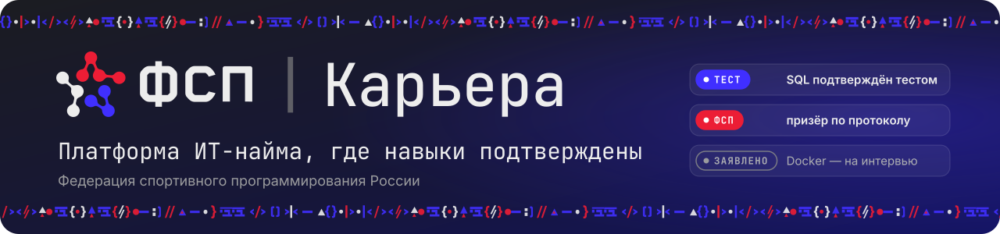
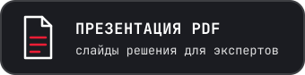
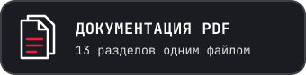
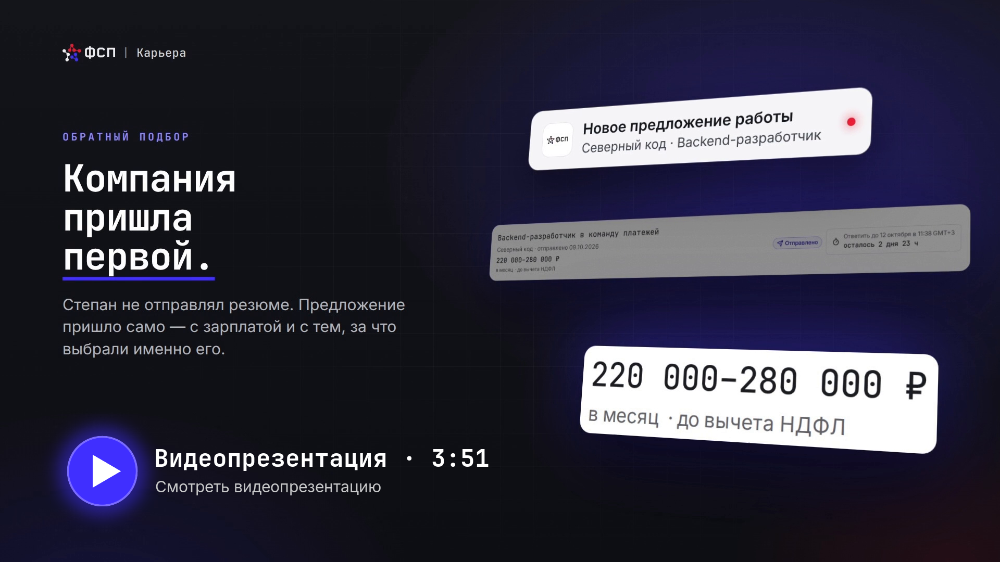

<p align="center">
  
</p>

<p align="center">
  <a href="https://fsp-career.volkv.com/demo"></a>
  <a href="https://fsp-career.volkv.com/presentation.pdf"></a>
  <a href="https://fsp-career.volkv.com/documentation.pdf"></a>
</p>

<p align="center">
  <a href="https://fsp-career.volkv.com/presentation.mp4">Видео (mp4)</a> ·
  <a href="https://fsp-career.volkv.com/documentation.docx">Документация DOCX</a> ·
  <a href="#документация">Документация (Markdown)</a> ·
  <a href="https://fsp-career.volkv.com/api/docs">API (Swagger)</a> ·
  <a href="https://fsp-career.volkv.com/api/v1/openapi.json">OpenAPI</a>
</p>

<p align="center">
  <a href="https://fsp-career.volkv.com/presentation.mp4"></a>
</p>

# ФСП | Карьера

**Платформа ИТ-найма, где навыки подтверждены: категорию кандидату даёт тест, а работодатель сам выходит на него с
предложением и зарплатой.**

Кандидат проходит опрос и тест на заявленный грейд и получает категорию — «специализация × грейд». Результаты соревнований
ФСП и другие проверяемые источники подтверждают навыки, но грейд не меняют. Работодатель описывает, кого ищет, получает
подборку из подходящих категорий и первым отправляет предложение — вакансия для этого не нужна.

## Как проверить за 5 минут

Стенд: **https://fsp-career.volkv.com/demo** — пароль не нужен. Люди и компании вымышленные, соревнования — реальные
соревнования ФСП. Каждый посетитель получает свою копию данных: ваши действия не видны другим.

1. **Работодатель.** На `/demo` войдите за Ю-1 — «Северный код». «Потребности» → опишите, кого ищете, текстом →
   «Разобрать и сохранить» → «Подтвердить». Вы увидите рекомендованные категории с числом кандидатов.
2. **Подборка.** «Собрать подборку»: у каждого кандидата — «Почему подходит» с источником довода и разложение счёта.
   В карточке — достижения ФСП с квитанцией проверки.
3. **Предложение.** В готовой подборке «Северного кода» отмечен К-1: «Предложить работу» — вилка в рублях и пункты
   «почему вы», вакансия не нужна.
4. **Новый кандидат.** На `/demo` нажмите «Новый кандидат в этой сессии»: согласие → опрос → заявленный грейд → тест.
   Тест вы проходите сами; работодатели вашей сессии найдут кандидата по категории, которую он даст.
5. **Вторая сторона.** Ссылку сессии с `/demo` откройте во втором профиле браузера и войдите за К-1: «Приглашения» →
   «Принять и раскрыть выбранное». Компания получает только выбранные контакты.

Подробный маршрут на 15 минут и полный — на 2 часа: [руководство пользователя](docs/submission/10-user-guide.md#как-жюри-проверить-за-15-минут).

## Что внутри

- **Тест на грейд.** Задания — параметрические семейства: у каждого кандидата свои экземпляры, перенос чужих ответов не помогает.
  Практика проверяется в песочнице, решение о грейде принимает последовательный тест Вальда (SPRT) — [04](docs/submission/04-testing.md).
- **Подбор с объяснением.** Потребность → рекомендованные категории → подборка, у каждой позиции — причина и разложение счёта
  — [05](docs/submission/05-matching.md).
- **Предложение первым.** Вилка «от–до» в рублях обязательна, «почему вы» — со ссылками на подтверждения; контакты закрыты,
  пока кандидат не примет конкретную версию условий — [01](docs/submission/01-solution.md).
- **ФСП ID и квитанции ФСП.** Вход через ФСП ID (OIDC, совместим с Keycloak), достижения — из API ФСП (на стенде — имитатор); у каждого показанного
  факта — подписанная квитанция, которую работодатель проверяет сам — [07](docs/submission/07-fsp-registry.md).
- **Приватность и 152-ФЗ.** Раздельные версионированные согласия, псевдонимная карточка по умолчанию, шифрование
  персональных данных на уровне полей, согласие законного представителя для 14–17 лет — [01](docs/submission/01-solution.md#безопасность-и-152-фз).
- **Связь с ATS.** Исходящие события по спецификации Standard Webhooks и публичный API `/api/v1` — [12](docs/submission/12-ats.md),
  [08](docs/submission/08-api.md).
- **Защита от фиктивных вакансий.** Проверка компании оператором ФСП, модерация текстов, жалобы — [11](docs/submission/11-antifraud.md).
- **Качество измерено.** Подбор: nDCG@10 0,657 против 0,324 у поиска по тексту (dev-набор, синтетический эталон); 40 одновременных
  пользователей на стенде без ошибок; панель качества администратора проверяет равенство исходов по правилу 4/5 —
  [06](docs/submission/06-validation.md).

Модели помогают, но не решают: каждый извлечённый факт подкреплён цитатой, категория от моделей не зависит, без них продукт
работает целиком в явном упрощённом режиме. Какая модель, куда уходит текст и как поставить свою — [`docs/models.md`](docs/models.md).

## Демо-учётки

Вход — только через `/demo`. Учётки героев — шаблон, с которого копируется каждая демо-сессия; паролем в них не войти.

| Код | Роль                                | Что проверить                                                                             |
| --- | ----------------------------------- | ----------------------------------------------------------------------------------------- |
| К-1 | кандидат с ФСП                      | Middle Backend подтверждён уверенно; ждёт предложения «Северного кода»                    |
| К-2 | кандидат без ФСП                    | Senior не подтверждён, Middle подтверждён тестом ниже; предложение непроверенной компании |
| К-3 | кандидат с ФСП                      | тест Middle Backend — «не определено»; КМС по алгоритмическому программированию           |
| К-4 | кандидат, 16 лет                    | законный представитель ждёт проверки оператором ФСП                                       |
| К-5 | кандидат без ФСП                    | принял предложение «Северного кода», контакты раскрыты, договорились о собеседовании      |
| К-6 | кандидат без ФСП                    | две категории: Middle Backend и Middle QA                                                 |
| Ю-1 | «Северный код», владелец и рекрутер | проверенная компания: потребность, подборка, предложения, найм                            |
| Ю-2 | «Тёплый стек», владелец             | партнёр финала Кубка России 2025 по продуктовому программированию                         |
| Ю-3 | «Новая команда», владелец           | компания на проверке: каталог закрыт                                                      |
| —   | оператор ФСП                        | проверка компаний и представителей, возражения, воронка исходов                           |
| —   | администратор                       | модели, справочники, банк заданий, политики, журнал                                       |

Почты героев, сроки жизни сессий, письма сессии и загрузка своего резюме — в
[руководстве пользователя](docs/submission/10-user-guide.md#демо-сессия).

## Запуск локально

Нужны Docker с Compose v2, `make`, git и Linux с cgroup v2 (для песочницы исполнения кода).

```sh
make up      # собрать образы и поднять весь стек
make down    # остановить
```

Приложение — http://localhost:57300, письма — Mailpit http://localhost:57825. Ключ модели и видеокарта не нужны.
Первая сборка — несколько минут. Демо-данные локально — `DEMO_MODE=true` в `.env` перед `make up`.

Состав стека, адреса и демо-данные — [09. Сборка и развёртывание](docs/submission/09-deployment.md); команды, порты и
полная проверка (`make check-all`) — [`docs/development.md`](docs/development.md).

## Документация

Одним файлом: [PDF](https://fsp-career.volkv.com/documentation.pdf) · [DOCX](https://fsp-career.volkv.com/documentation.docx)
(собирает `pnpm docs:build` из разделов ниже).

| Раздел                                                                  | Пункт ТЗ 3.4                            |
| ----------------------------------------------------------------------- | --------------------------------------- |
| [01. Описание решения и архитектура](docs/submission/01-solution.md)    | дополнительно                           |
| [02. Функциональная схема](docs/submission/02-functional-scheme.md)     | функциональная архитектура              |
| [03. Компонентная схема](docs/submission/03-component-scheme.md)        | компонентная архитектура                |
| [04. Механика тестирования](docs/submission/04-testing.md)              | механика тестирования и её устойчивость |
| [05. Подбор и категоризация](docs/submission/05-matching.md)            | механика подбора и логика категоризации |
| [06. Валидация](docs/submission/06-validation.md)                       | процедура валидации и её результаты     |
| [07. Интеграция с реестром ФСП](docs/submission/07-fsp-registry.md)     | схема интеграции с реестром ФСП         |
| [08. Описание API](docs/submission/08-api.md)                           | описание API                            |
| [09. Сборка и развёртывание](docs/submission/09-deployment.md)          | сборка, развёртывание, локальный запуск |
| [10. Руководство пользователя](docs/submission/10-user-guide.md)        | дополнительно                           |
| [11. Антифрод](docs/submission/11-antifraud.md)                         | дополнительно                           |
| [12. Интеграция с ATS](docs/submission/12-ats.md)                       | дополнительно                           |
| [13. Технологии, версии и лицензии](docs/submission/13-technologies.md) | библиотеки и компоненты с версиями      |

Каждый пункт задания — где он в продукте и каким тестом проверен:
[соответствие требованиям](docs/submission/10-user-guide.md#соответствие-требованиям-задачи).

Для разработчиков: [`docs/domain.md`](docs/domain.md) — предметная область, [`docs/contracts.md`](docs/contracts.md) — контракты,
[`docs/models.md`](docs/models.md) — модели, [`docs/development.md`](docs/development.md) — разработка,
[`docs/deploy.md`](docs/deploy.md) — стенд.

## Лицензия

Код — [MIT](LICENSE). Товарные знаки и логотипы ФСП, шрифты и сторонние компоненты — [`NOTICE`](NOTICE).
