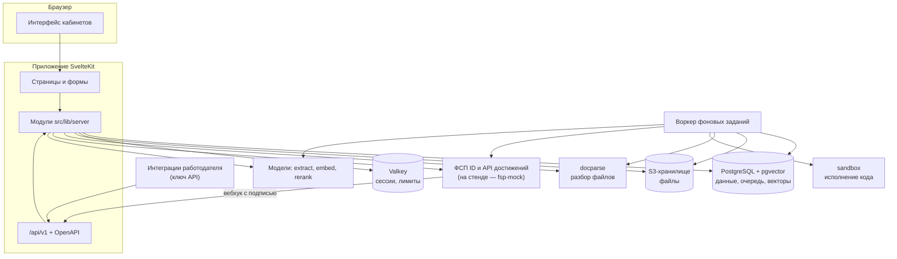

# Описание решения и архитектура

## Задача и обратная механика найма

«ФСП Карьера» — отраслевая платформа ИТ-найма, в которой инициатива контакта принадлежит работодателю. Кандидат не рассылает
отклики: он проходит опрос и тест на заявленный грейд и получает **категорию** — пару «специализация × грейд» (Backend,
Frontend, Mobile, Data Science / ML, QA, DevOps / SRE; Intern, Junior, Middle, Senior), подтверждённую решением теста.
Работодатель описывает потребность, получает рекомендованные категории и подборку кандидатов из них и первым выходит на
выбранного кандидата с **предложением**: описание работы, вилка «от–до» в рублях, способ связи, срок ответа и пункты «почему вы»
со ссылками на подтверждения из профиля.

Отличие от прямого отклика:

| | Прямой отклик | Обратная механика платформы |
|---|---|---|
| Кто начинает | кандидат | работодатель |
| На чём основан выбор | текст резюме | категория, подтверждённая тестом, проверяемые факты (ФСП, тесты, публичные профили) |
| Что кандидат знает до контакта | название вакансии | компанию с меткой проверки, вилку в рублях, формат, что именно компания увидела в его профиле |
| Когда работодатель видит контакты | сразу | только после принятия кандидатом конкретной версии условий |
| Как меняются условия | без следа | только новой версией: кандидат видит отличия и принимает её отдельно |

Классический отклик кандидата на опубликованную вакансию остаётся дополнительным сценарием, а не основным путём.

## Роли и кабинеты

| Роль | Кабинет | Что может |
|---|---|---|
| Кандидат | `/me` | профиль и резюме, опрос, тест, категория и её история, видимость полей и блок-лист компаний, приглашения и ответ на них, согласия, выгрузка и удаление своих данных |
| Владелец компании | `/company` | профиль компании, заявка на проверку, команда, вакансии, потребности и подборки, предложения, этапы найма, ключи API |
| Рекрутер | `/company` | каталог, вакансии, потребности и подборки, предложения, этапы найма; без управления командой и ключами |
| Оператор ФСП | `/operator` | проверка компаний и полномочий их представителей, модерация вакансий с заблокированным текстом, возражения против результатов теста, пересмотр попыток, конфликты даты рождения, импорт результатов ФСП, партнёрства соревнований, воронка карьерных исходов |
| Администратор | `/admin` | роли персонала, справочники и политики, выпуски банка заданий, режим моделей, панель качества, журнал действий |

Роль сама по себе доступа к объекту не даёт: каждое действие проверяется функцией `can(actor, permission, object)`, которая
сочетает роль с правилом объекта (своя компания, своё приглашение, видимость кандидата в контексте). Членство и статус компании
проверяются на каждом запросе, в том числе по ключу API; удалённый сотрудник теряет доступ сразу.

## Сквозной сценарий

1. **Регистрация.** Почта и пароль или вход через ФСП ID — один поток: подтверждение почты, выбор роли, дата рождения (ФСП ID её
   не передаёт), пользовательское соглашение, согласие на обработку данных на отдельном экране.
2. **Опрос и заявленный грейд.** Кандидат выбирает направление, специализацию, стек и ожидания; по его подтверждённым фактам
   платформа подсказывает грейд, кандидат заявляет свой.
3. **Тест.** Задания под специализацию и заявленный грейд, в том числе практика с исполнением кода в песочнице; решение
   принимает последовательная процедура (раздел «Механика тестирования кандидатов»).
4. **Категория.** Подтверждённое решение назначает категорию; кандидат видит объяснение и может возразить — возражение
   рассматривает человек. Путь одинаков для кандидатов с историей ФСП и без неё: достижения ФСП усиливают профиль и
   объяснение, но категорию назначает только тест.
5. **Поиск работодателем.** Потребность текстом или формой → рекомендованные категории → подборка, ранжированная с разложением
   счёта и объяснением места каждого кандидата (раздел «Механика подбора и категоризация»).
6. **Предложение и раскрытие.** Компания отправляет предложение; кандидат принимает конкретную версию условий и выбирает, какие
   контакты раскрыть этой компании. Дальше стороны независимо отмечают этапы найма и исход.

## Архитектура: frontend, backend, хранение

Решение — модульный монолит на SvelteKit с явным разделением слоёв и несколько изолированных сервисов вокруг него.

- **Frontend** — страницы SvelteKit (Svelte 5, Tailwind CSS 4), отрисовка на сервере с последующей гидратацией; один
  веб-интерфейс для всех ролей с кабинетами `/me`, `/company`, `/operator`, `/admin`.
- **Backend** — серверная часть того же приложения (adapter-node, Node 24): обработчики страниц и публичный API `/api/v1`
  вызывают функции модулей `src/lib/server/*`. Фоновую работу выполняет отдельный процесс-воркер из того же образа.
- **Слой хранения** — PostgreSQL 17 с pgvector (данные, очередь заданий, векторы), Valkey (сессии, лимиты частоты, состояние
  входа через ФСП ID, ответы для повторов по ключу идемпотентности, режим моделей), S3-совместимое хранилище (файлы резюме и документов).

**Модули и их границы.** У каждой таблицы один модуль-владелец, который единственный в неё пишет; остальные читают через его
функции. Основные модули:

| Модуль | Ответственность |
|---|---|
| `auth`, `access` | учётки, сессии, ФСП ID, роли персонала, права и политика допуска компании |
| `companies` | компании, проверка, команда, ключи API, партнёрства соревнований |
| `consent` | правовые документы, согласия, законные представители, раскрытия |
| `candidates`, `profile`, `visibility` | профиль кандидата, возраст, проекции карточки и функция видимости `canShow` |
| `evidence`, `fsp`, `external-profiles` | доказательства в три слоя (факт → утверждение → вывод о навыке), синхронизация ФСП, публичные профили Codeforces и GitHub, квитанции проверки |
| `resumes`, `documents`, `ml` | разбор резюме через `docparse` и адаптер моделей, цитаты, конверт результата модели |
| `assessments`, `grades`, `categories` | банк заданий, попытки, решение о грейде, категория, возражения, подтверждение категории по QR |
| `needs`, `shortlists`, `matching`, `market` | потребность, подборка, соответствие «вакансия ↔ кандидат», рынок категории |
| `vacancies`, `invitations`, `hiring` | вакансии и проверка текста, предложения и версии условий, процесс найма |
| `notifications`, `audit`, `erasure`, `jobs` | уведомления, журнал действий, удаление данных, очередь фоновых заданий |

**Отдельные сервисы** вынесены туда, где нужна изоляция или другой рантайм: разбор файлов `docparse` (Python), песочница исполнения
кода `sandbox` (go-judge), имитатор ФСП ID и реестра ФСП `fsp-mock`, эмбеддер `embedder` (llama.cpp). Каждый общается с
приложением по своему контракту, а приложение валидирует ответы по схеме контракта.

## Потоки данных

- **Резюме → факты.** Файл (PDF, DOCX, RTF, DOC, ODT, скан) сохраняется в хранилище; задание `resume.parse` отдаёт его
  `docparse` и получает блоки текста с координатами, `resume.extract` извлекает из блоков утверждения — каждое с цитатой, которую
  код находит в документе. Кандидат подтверждает, правит или отклоняет предложенные поля.
- **Доказательства → профиль.** Факты источников (ФСП, тесты платформы, публичные профили, резюме) с уровнем доверия дают
  утверждения и выводы о навыках; расчёт доказательств детерминирован и версионирован, категорию он не назначает.
- **Тест → категория.** Попытка теста идёт кластерами заданий; практика уходит в песочницу через очередь; решение о грейде
  назначает или не назначает категорию.
- **Потребность → подборка.** Текст потребности разбирается моделью или правилами в форму; форма даёт категории; подборка
  ранжирует кандидатов этих категорий, видимых компании, с сохранённым разложением счёта.
- **Предложение → контакт.** Версия условий неизменна; принятие с согласием на раскрытие выбранных полей создаёт запись
  раскрытия, после которой компании видны контакты.

Вся тяжёлая работа — фоновые задания в PostgreSQL (`FOR UPDATE SKIP LOCKED`, аренда с пульсом, повторы с паузой, условная запись
результата по версии входа): задание, чей вход устарел, пока оно шло, свой результат не записывает.

## Контейнеризация

Каждый компонент — Docker-контейнер; весь стенд поднимает `docker compose` одной командой (`make up`, файл `compose.yaml`).
Демонстрационный стенд собран из отдельного файла `docker-compose.prod.yml` с явными лимитами памяти каждого сервиса без свопа;
сумма лимитов — 5,3 ГБ, без нагрузки стек занимает около 1,4 ГБ. Состав сервисов, сети и лимиты — раздел «Компонентная схема»,
порядок запуска — раздел «Сборка, развёртывание и локальный запуск».

## Аутентификация

- **Почта и пароль:** пароль хранится строкой Argon2id; серия неудачных входов блокирует вход по учётке и по адресу.
- **ФСП ID:** собственный OIDC-клиент (Authorization Code + PKCE S256, `state`, `nonce`, проверка `iss`, подпись ID-токена по JWKS).
  Пути и discovery совпадают с Keycloak, на котором работает ФСП ID; совместимость подтверждена интеграционным тестом против
  контейнера Keycloak 26.8 с realm `fsp` (раздел «Интеграция с реестром ФСП»). Переход с имитатора на настоящий ФСП ID — смена
  трёх переменных окружения.
- **Связь профиля с ID участника ФСП:** внешняя идентичность `(issuer, subject)` и связь со спортсменом хранятся раздельно;
  автосвязка по почте запрещена, привязка к существующей учётке требует свежего входа с обеих сторон.
- **Сессии:** cookie `__Host-session` (`HttpOnly`, `Secure`, `SameSite=Lax`), в Valkey — только SHA-256 идентификатора; простой
  7 дней, абсолютный срок 30 дней. Для чувствительных операций (привязка ФСП ID, смена пароля, создание ключа API, удаление) нужна
  аутентификация не старше 10 минут.

## Безопасность и 152-ФЗ

- **Согласия.** Правовые документы версионированы и хранятся с хэшем текста; согласия — события выдачи и отзыва с доказательством
  (адрес, браузер, хэш документа). Виды согласий раздельны: обработка профиля, показ карточки работодателям, получение
  достижений ФСП, раскрытие контактов конкретной компании по конкретному предложению, Telegram-уведомления. Для кандидатов
  14–17 лет согласия дополнительно подписывает законный представитель по ссылке из письма.
- **Приватность по умолчанию.** Работодатель видит псевдонимную карточку; состав карточки определяет функция `canShow` по
  зрителю и контексту. Поля пола, гражданства, семейного положения в модели отсутствуют, тексты вакансий и предложений
  проверяются на дискриминационные требования (раздел «Защита от фиктивных вакансий»).
- **Разграничение прав.** Объектные права (раздел «Роли и кабинеты»); персонал видит данные кандидата только в контексте дела,
  и каждый такой доступ пишется в журнал действий.
- **Хранение секретов.** Почта, ФИО, телефоны, идентификаторы чатов шифруются на уровне полей (AES-256-GCM, контекст поля —
  дополнительные данные шифра), поиск по почте — по HMAC. Ключи API хранятся как SHA-256 и показываются один раз; секреты
  окружения в репозиторий не попадают.
- **Удаление.** Запрос удаления сразу отзывает сессии и ключи и скрывает кандидата; задание очистки удаляет данные вместе с
  производными (векторы, соответствия, квитанции, файлы); реестр удалений переживает восстановление из резервной копии.

## Модели и обработка текста

Модели подключаются через **один адаптер** (`src/lib/server/ml`) с тремя независимыми операциями к OpenAI-совместимому рантайму:
`extract` (разбор резюме и текста вакансии в факты с цитатами, structured output по JSON Schema), `embed` (векторы профилей,
вакансий и запросов), `rerank` (переранжирование окна кандидатов). Каждая операция настраивается своим адресом и может работать
на своей машине; по умолчанию все рантаймы — в закрытом контуре. Проверенная конфигурация: Qwen3-8B-AWQ и bge-reranker-v2-m3 на
vLLM (одна видеокарта 12 ГБ), bge-m3 Q8_0 на CPU (llama.cpp, сервис стенда).

Модели улучшают разбор и поиск, но ничего не решают: категория назначается только тестом, каждый извлечённый факт подкреплён
цитатой, которую код находит в документе. Выключенная администратором или недоступная операция переводит продукт в явный режим
без модели:

| Операция недоступна | Что делает продукт | Что видит пользователь |
|---|---|---|
| `extract` | резюме и потребность разбирают детерминированные правила с теми же проверками цитат | «Разбор выполнен без модели — проверьте поля» |
| `embed` | поиск только по словам (полнотекстовый); векторы досчитываются, когда эмбеддер вернётся | «Семантический поиск недоступен — поиск по словам» |
| `rerank` | ранжирование без компонента реранкера | в объяснении ранжирования компонент отмечен как недоступный |

Ни в одном режиме ответ модели не подменяется выдуманным.

## Производительность и масштабирование

Ориентир ТЗ — десятки одновременных пользователей. Целевые бюджеты p95 на стенде 4 CPU / 5,7 ГБ: карточка и страницы кабинета —
800 мс, холодная подборка и поиск — 2,5 с, тёплые — 500 мс, ответ на задание теста без песочницы — 500 мс, отправка предложения —
800 мс; без моделей бюджеты те же, кроме холодной подборки — 3 с.

Узкие места и решения:

- **Ранжирование подборки** — кэш ранжирования в памяти процесса на 120 с, тяжёлый пересчёт соответствий вынесен в задания `match.refresh`.
- **Песочница и разбор файлов** — дорогие по памяти операции идут через очередь с ограничением параллельности; на стенде —
  по одной, локально — по две.
- **Модели** — отдельные машины; недоступность модели не блокирует операции (режим без модели).

Горизонтальное масштабирование: состояние пользователя приложение в процессе не хранит (сессии и лимиты — в Valkey, в памяти
процесса — только кэш ранжирования), поэтому экземпляры приложения ставятся за балансировщиком; воркеров может быть несколько — захват заданий через `SKIP LOCKED` и планировщик под
advisory lock исключают двойное выполнение; рантаймы моделей и песочница масштабируются отдельно от приложения.

## Открытый код

Код решения распространяется по лицензии MIT (`LICENSE`); товарные знаки ФСП, шрифты и сторонние компоненты перечислены в
`NOTICE`. Репозиторий содержит исходники без сборки и обфускации; сторонние компоненты — открытые, их версии и лицензии —
раздел «Технологии, версии и лицензии».
