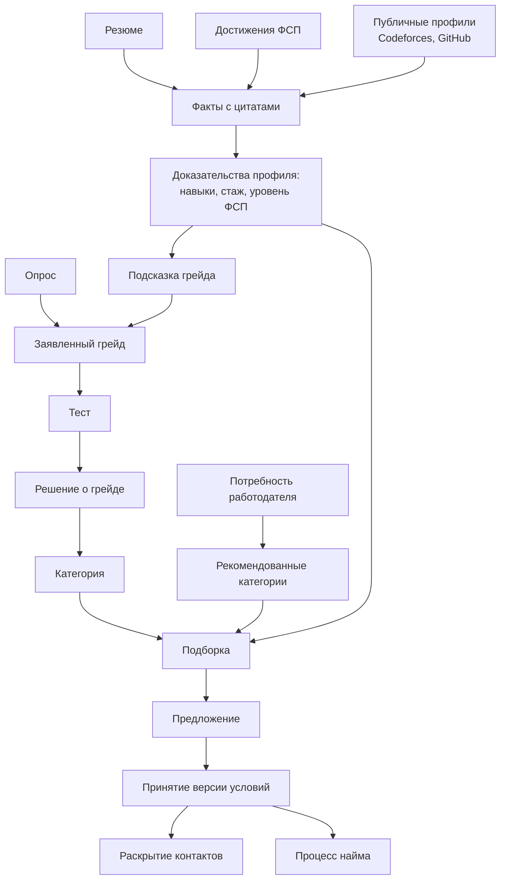
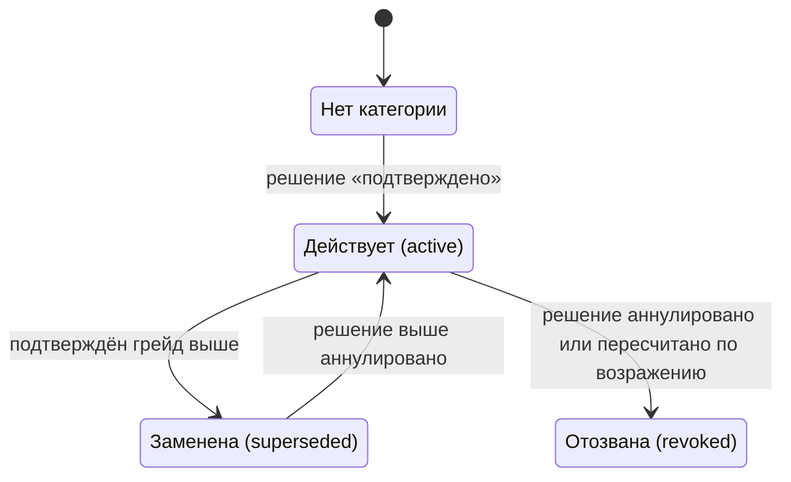
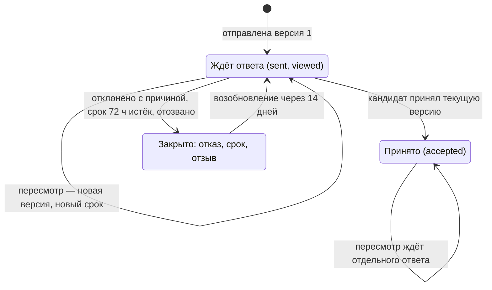
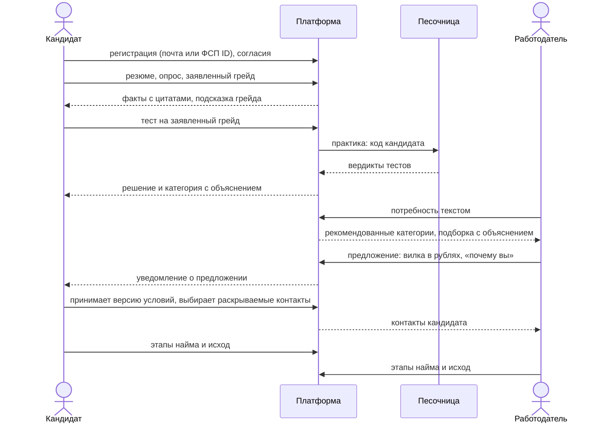

# Функциональная схема

## Функции кабинета кандидата

| Функция | Что делает | Где |
|---|---|---|
| Профиль | ФИО, контакты, желаемая должность, мягкие навыки, опыт, указанный вручную | `/me/profile` |
| Резюме | загрузка PDF, DOCX, RTF, DOC, ODT или скана; разбор во все поля профиля, у каждого предложенного значения — цитата из документа; кандидат принимает, правит или отклоняет | `/me/resume` |
| PDF-профиль | профиль стандартного вида — приватно кандидату; QR ведёт на подписанное подтверждение категории без контактов | `/me/profile` |
| Достижения ФСП | привязка ФСП ID и согласие на получение достижений; результаты с квитанциями проверки | `/account`, `/me/consents` |
| Опрос и грейд | направление, специализация, стек, ожидания; подсказка грейда по фактам; заявленный грейд | мастер онбординга, `/me/category` |
| Тест | задания под специализацию и заявленный грейд, практика в песочнице, результат с объяснением, возражение против результата и его отзыв | `/me/tests` |
| Категория и грейд | действующая категория, история опросов, заявлений, попыток и решений, когда откроется следующий тест, поданные возражения и их статус, спрос на навыки своей категории | `/me/category` |
| Приглашения | входящие предложения с версиями условий и отличиями, ответ на конкретную версию, выбор раскрываемых контактов, этапы найма | `/me/invitations` |
| Вакансии | опубликованные вакансии платформы с соответствием профилю | `/me/vacancies` |
| Видимость и согласия | что видно работодателю в каталоге и после раскрытия, блок-лист компаний, раздельные согласия | `/me/visibility`, `/me/consents` |
| Мои данные | выгрузка всего, что платформа хранит о кандидате; удаление аккаунта | `/me/export`, `/account/delete` |

## Функции кабинета работодателя

| Функция | Что делает | Где |
|---|---|---|
| Компания | регистрация по ИНН, профиль (описание, направление деятельности, контакты), заявка на проверку оператором | `/company/profile` |
| Команда и права | владелец приглашает рекрутеров; права проверяются на каждом запросе | `/company/profile/team` |
| Вакансии | создание из текста с разбором полей, вилка в рублях, проверка текста на дискриминационные требования, публикация | `/company/vacancies` |
| Потребность | «опишите, кого ищете» текстом или формой; разбор в роль, грейд, навыки; рекомендованные категории с числом кандидатов | `/company/needs` |
| Подборка | кандидаты рекомендованных категорий с разложением счёта, пунктами «почему», пробелами и «что проверить»; уточнения, «что если», отметки | `/company/shortlists/{id}` — из потребности `/company/needs/{id}` |
| Каталог и карточка | поиск по специализации, грейду, стеку, достижениям ФСП, формату, региону; псевдонимная карточка с квитанциями; сравнение кандидатов | `/company/candidates` |
| Предложение | описание, вилка в рублях, формат, способ связи, «почему вы» с источниками; пересмотр — новой версией | `/company/invitations` |
| Этапы найма | собеседование, оффер, выход; исход со стороны компании | `/company/hiring` |
| Пул партнёра | финалисты соревнования, где компания — партнёр, по отдельному согласию кандидатов | `/company/partner-pools` |
| Ключи API | ключи с подмножеством прав создателя для интеграций (раздел «Описание API») | `/company/profile/keys` |

## Функции оператора ФСП и администратора

| Роль | Функция | Где |
|---|---|---|
| Оператор | проверка компании: реестр юрлиц, способ подтверждения полномочий заявителя, решение с причиной; приостановка и возврат | `/operator/companies` |
| Оператор | модерация вакансий, чей текст заблокирован проверкой: опубликовать, вернуть на правку, отклонить | `/operator/vacancies` |
| Оператор | возражения кандидатов против результата теста: рассмотрение человеком до 30 дней, исход с объяснением | `/operator/objections` |
| Оператор | пересмотр и аннулирование попыток теста с полным набором артефактов | `/operator/assessments` |
| Оператор | полномочия законных представителей, конфликты даты рождения | `/operator/representatives`, `/operator/ages` |
| Оператор | импорт результатов ФСП файлом выгрузки или протоколами; партнёрства соревнований | `/operator/fsp-import`, `/operator/partnerships` |
| Оператор | воронка карьерных исходов по стадиям и разрезам | `/operator/outcomes` |
| Администратор | роли персонала, справочники таксономии, продуктовые и правовые политики, выпуски банка заданий | `/admin/staff`, `/admin/taxonomy`, `/admin/policies`, `/admin/bank` |
| Администратор | режим моделей (включение и выключение операций без перезапуска), панель качества, журнал действий | `/admin`, `/admin/quality`, `/admin/audit` |

## Потоки данных между функциями

- **Резюме и факты → категория.** Факты и доказательства профиля дают подсказку грейда и пункты «почему вы», но категорию
  назначает только решение теста. Замена резюме или изменение данных ФСП меняют доказательства и ранжирование, а действующую
  категорию не трогают.
- **Категория → выдача работодателю.** Потребность даёт рекомендованные категории; в подборку попадают кандидаты этих категорий,
  которых функция видимости показывает компании. Кандидат без категории в категории и их числа не входит: в подборке он виден
  отдельной группой «грейд не подтверждён» после всех подтверждённых — по заявленной специализации и грейду, которые
  доказательством не считаются, — и остаётся в общем каталоге с меткой «категория не подтверждена».
- **Приглашение → контакт.** До принятия компания видит псевдонимную карточку; принятие кандидатом конкретной версии условий с
  согласием на раскрытие выбранных полей создаёт запись раскрытия — только тогда компании видны контакты.

## Жизненные циклы

**Категория кандидата.** Категория — пара «специализация × грейд», в специализации действует одна. Назначается, заменяется и
отзывается только решениями теста:

- без категории доступен тест заявленного грейда; после неудачи сразу доступен грейд ниже, повтор того же — через 14 дней, на
  другой форме;
- с категорией доступен только тест следующего грейда — через 90 дней от назначения; уверенный результат открывает его сразу, один
  раз, на 30 дней;
- не больше двух засчитанных попыток на грейд специализации за 180 дней; провал теста выше не понижает подтверждённый грейд;
- аннулирование попытки или исход возражения пересчитывают категорию по оставшимся действительным решениям.

**Предложение.** Отправленные условия неизменны; пересмотр — новая версия, кандидат видит отличия и принимает её отдельно.
Срок ответа на версию — 72 часа. После отказа, истечения или отзыва повторное предложение той же компании — новая версия той же
линии не раньше чем через 14 дней, а снижение вилки помечается кандидату.

После принятия открывается **процесс найма**: стороны независимо сообщают этапы (собеседование назначено и проведено, оффер
сделан и принят) и исход; исход не выводится из молчания — без сообщений он остаётся «неизвестен», расхождение сторон видно обеим.

**Вакансия компании.** `draft → published ⇄ paused → closed`; если проверка текста блокирует публикацию или правку, вакансия уходит
на модерацию (`pending_moderation`), откуда оператор возвращает её в каталог, на правку или закрывает. Закрытие вакансии отзывает
неотвеченные предложения, чья текущая версия её называет.

## Схема сквозного сценария

