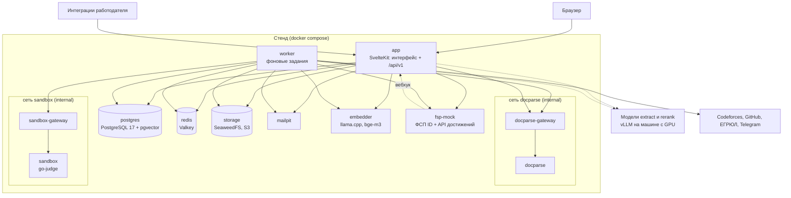

# Компонентная схема

## Компоненты и их ответственность

Каждый компонент — отдельный контейнер; состав одинаков в локальном `compose.yaml` и в файле стенда `docker-compose.prod.yml`
(на стенде добавлен контейнер туннеля к машине с моделями).

| Сервис | Образ и технология | Ответственность |
|---|---|---|
| `app` | образ приложения: Node 24, SvelteKit (adapter-node) | веб-интерфейс всех ролей, публичный API `/api/v1`, OpenAPI и Swagger UI, вебхуки ФСП и Telegram; при старте применяет миграции и публикует справочники, правовые документы, политики и выпуски банка заданий |
| `worker` | тот же образ, команда воркера | фоновые задания: разбор резюме, синхронизация ФСП, расчёт доказательств, соответствия, векторы, сроки приглашений, уведомления, хранение и очистка, сброс демо-стенда; планировщик периодических заданий |
| `postgres` | PostgreSQL 17 с pgvector 0.8 | все данные продукта, очередь заданий, векторы профилей и вакансий, журнал действий (партиции по месяцам) |
| `redis` | Valkey 9 (совместим с Redis по протоколу) | сессии, лимиты частоты, состояние входа через ФСП ID, ответы для повторов по ключу идемпотентности, режим моделей |
| `storage` | SeaweedFS 4 (S3 API) | файлы резюме, документы полномочий, пакеты результатов ФСП, артефакты попыток |
| `docparse` + `docparse-gateway` | Python 3.13 (Starlette, pdfplumber, python-docx, LibreOffice headless, Tesseract) за nginx | разбор PDF, DOCX, RTF, DOC, ODT, сканов и текста в блоки с координатами и таблицы |
| `sandbox` + `sandbox-gateway` | go-judge с Python, JavaScript, TypeScript, Go, C++, Java, Kotlin за nginx | исполнение кода кандидатов в практических заданиях теста |
| `fsp-mock` | Node 24, `oidc-provider` | имитатор ФСП ID (OIDC с путями Keycloak) и API достижений ФСП с вебхуками; синтетические спортсмены на реальных соревнованиях ФСП |
| `embedder` | llama.cpp server, модель bge-m3 Q8_0 на CPU | векторы для семантического поиска |
| `mailpit` | Mailpit | приём почты стенда (подтверждение адреса, сброс пароля, уведомления) |
| `gpu-tunnel` (только стенд) | sshd в контейнере | обратный туннель к машине с GPU, где работают модели `extract` и `rerank` |

Внешние для стенда компоненты: рантайм моделей `extract` и `rerank` (vLLM на машине с GPU), обратный прокси с TLS (Caddy сервера),
почтовый релей (на стенде не используется — письма остаются в Mailpit).

## Связи между компонентами

| Откуда → куда | Протокол | Синхронно или через очередь |
|---|---|---|
| Браузер → `app` | HTTPS, HTML и JSON | синхронно |
| Интеграция работодателя → `app` | HTTPS, `/api/v1`, ключ API | синхронно |
| `app`, `worker` → `postgres` | SQL (postgres.js, пул по 10 соединений) | синхронно; задания ставятся в той же транзакции, что изменение |
| `app`, `worker` → `redis` | протокол Redis | синхронно |
| `app`, `worker` → `storage` | S3 API | синхронно |
| `app`, `worker` → `docparse-gateway` → `docparse` | HTTP `POST /v1/parse` | резюме — заданием `resume.parse`; предпросмотр пакета результатов ФСП оператором — синхронно |
| `worker` → `sandbox-gateway` → `sandbox` | HTTP API go-judge | из задания `test.run`; ответ кандидату — `202`, пока практика ждёт песочницу |
| `app` → `fsp-mock` (ФСП ID) | OIDC: discovery, authorization, token, JWKS | синхронно при входе |
| `worker` → `fsp-mock` (API достижений) | HTTP `fsp-achievements/v1` с токеном и подписанным утверждением о согласии | из задания `fsp.sync` |
| `fsp-mock` → `app` | вебхук `POST /api/v1/integrations/fsp/webhooks`, подпись HMAC-SHA-256 | приложение отвечает `202` и ставит `fsp.sync` |
| `app`, `worker` → `embedder` | HTTP `POST /v1/embeddings` | запрос поиска — синхронно с коротким сроком; векторы профилей и вакансий — заданиями |
| `app`, `worker` → модели `extract`, `rerank` | HTTP, OpenAI-совместимый API | разбор вставленной потребности — синхронно; разбор резюме и пересчёты — заданиями |
| `app`, `worker` → почта, Telegram Bot API | SMTP, HTTPS | уведомления — заданием `notification.deliver` на каждую пару «уведомление × канал»; письма подтверждения адреса, сброса пароля и законному представителю — сразу после транзакции |

Очередь заданий — таблица `jobs` в PostgreSQL: захват `FOR UPDATE SKIP LOCKED`, аренда с пульсом, повтор с паузой
5 · 2^(n−1) с (не больше 10 минут), условная запись результата по версии входа. Периодические задания ставит планировщик внутри
воркера под advisory lock, отдельного cron-контейнера нет.

## Внешние системы

| Система | Как подключена | Статус |
|---|---|---|
| ФСП ID (Keycloak, realm `fsp`) | OIDC-клиент приложения; issuer, client id и secret — переменные окружения | на стенде — имитатор с тем же discovery; совместимость с Keycloak проверена тестом |
| Реестр достижений ФСП | адаптер `fsp-achievements/v1`: API по спортсмену, вебхук; пакетная загрузка выгрузок и протоколов оператором | на стенде — имитатор; реальный API — по спецификации федерации |
| ЕГРЮЛ | поиск по ИНН в публичном сервисе ФНС как подсказка оператору | включается настройкой `COMPANY_REGISTRY=egrul`; без неё оператор видит «реестр не настроен» |
| Codeforces, GitHub | публичные API: подтверждённые публичные профили кандидата | ежедневное обновление заданием |
| Telegram | Bot API: привязка чата по одноразовой ссылке, уведомления без персональных данных | включается токеном бота |
| ATS работодателей | публичный API с ключом компании | раздел «Интеграция с ATS работодателей» |

## Изоляция

- **Сети.** `docparse` и `sandbox` — каждый в своей внутренней сети (`internal: true`), где кроме него только шлюз nginx: выхода
  наружу нет, базы, хранилища и приложения они не видят. Хранилище — в своей сети только с `app` и `worker`: кроме S3 API процесс
  SeaweedFS отдаёт служебные API без аутентификации. На стенде все сети внутренние, кроме `egress`, где только те, кто ходит
  наружу (`app`, `worker`, `embedder`); в сети обратного прокси — только `app` и `fsp-mock`; порты на хост не публикуются.
- **Права контейнеров.** У приложения (на стенде), воркера, `docparse`, шлюзов, имитатора, эмбеддера и туннеля сброшены все
  capabilities и включён `no-new-privileges`; у воркера, `docparse`, песочницы, шлюзов, имитатора и эмбеддера файловая система только
  для чтения и `/tmp` в tmpfs. На стенде у каждого сервиса лимит памяти без свопа (раздел «Сборка, развёртывание и локальный
  запуск»), у прикладных — ещё лимиты CPU и числа процессов.
- **Песочница.** go-judge запускает каждую программу в своих пространствах имён пользователя, сети, монтирования и процессов с
  лимитами cgroup v2; для этого контейнеру нужны `SYS_ADMIN`, `SETUID`, `SETGID`, `SETFCAP`, свой профиль seccomp (профиль Docker
  по умолчанию плюс `pivot_root`) и `cgroup: private`. Внешняя стена — сам контейнер: без томов и сокета Docker, только во внутренней
  сети со шлюзом, с фиксированным бюджетом памяти, CPU и процессов. Остаточный риск — уязвимость ядра или go-judge.
- **Разбор файлов.** Каждый разбор — отдельный процесс со своим лимитом адресного пространства и временным каталогом; по
  таймауту группа процессов (вместе с LibreOffice и Tesseract) убивается целиком. Архивы проверяются на zip-бомбы, XML с
  `DOCTYPE`/`ENTITY` отвергается, LibreOffice не загружает внешние ссылки документа.
- **Закрытый контур моделей.** Текст резюме уходит только на адреса рантаймов из настроек; на стенде модели `extract` и `rerank`
  доступны через обратный SSH-туннель в отдельной сети `gpu`, куда подключены только `app`, `worker` и контейнер туннеля. В
  эмбеддер уходят только тексты уровня карточки каталога, без ФИО, компаний и текста резюме.

## Отказоустойчивость

- **Без моделей.** Каждая операция модели выключается отдельно; недоступная операция переводит продукт в явный упрощённый
  режим (разбор правилами, поиск по словам, ранжирование без реранкера) с пометкой для пользователя. От туннеля к моделям ничего не
  зависит при старте стенда.
- **Недоступность сервисов.** Адаптеры не бросают исключений через свою границу: каждый вызов возвращает результат или
  классифицированную ошибку с признаком повтора. Задание с повторяемой ошибкой возвращается в очередь с паузой; заблокированный
  разбор или занятая песочница (`busy`) не теряют работу. Синхронная операция без безопасного режима отвечает `503 degraded`.
- **Сбой процессов.** Задания упавшего воркера возвращает в очередь любой живой воркер по истечении аренды; штатная остановка
  отдаёт аренды без списания попытки. Обрыв соединения с базой даёт неудачную попытку и повтор; сервисы перезапускаются Docker
  (`restart: unless-stopped`).
- **Проверка состояния.** У каждого сервиса healthcheck; `docker compose up --wait` ждёт всех. `GET /api/health` приложения и
  `GET /health` воркера (счётчики заданий по типам) показывают деградацию зависимостей.

## Схема компонентов

