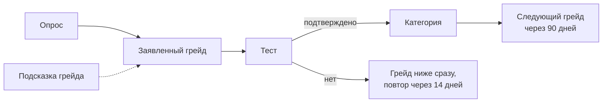
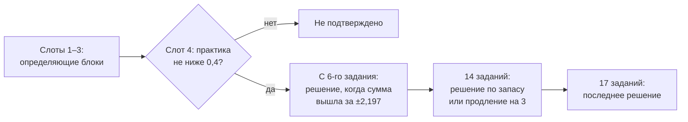

# Механика тестирования кандидатов

Категорию кандидата назначает только тест, поэтому заказчик требует от него трёх вещей: устойчивости к распространению заданий,
чтобы одинаковые задания не расходились между кандидатами, и воспроизводимого результата, который отделяет один грейд от другого.

| Требование | Как выполнено |
|---|---|
| Одинаковые задания не расходятся | у каждого кандидата свой экземпляр задания, ответ вычисляет код; классы задания с разным путём решения; повтор — на другой форме |
| Устойчивость механики | одна процедура решения с точной арифметикой; банк выпускается только после ворот семейств, проверки вместимости и симуляции траекторий |
| Воспроизводимость и разделение грейдов | точная характеристика процедуры и отчёт траекторий каждого выпуска; экраны и команды для самостоятельной проверки |
| Прокторинг и защита от подсказок | в MVP не заявляются; есть журнал сигналов попытки, остальное — идеи в конце раздела |

Источник истины — код: контракт теста `src/lib/server/assessments/contract/` (справочник категорий `catalog.ts`, процедура
`procedure.ts`, политика грейда `policy.ts`, банк и вместимость `bank.ts`), банк заданий `assessments/families/`, отчёты траекторий
`assessments/trajectories/`. Числа раздела взяты оттуда.

## Путь кандидата и категория

**Категория** — пара «специализация × грейд», подтверждённая решением теста: шесть специализаций (Backend, Frontend, Mobile, Data
Science / ML, QA, DevOps / SRE) на четыре грейда (Intern, Junior, Middle, Senior), 24 определения в справочнике версии `2026.10.3`.
Специализация открыта, когда она включена в справочнике **и** у неё есть действующий выпуск банка; включены все шесть,
и специализация без выпущенного банка закрыта. Путь одинаков для кандидатов с историей ФСП и без неё:



Подсказка грейда — совет с основаниями: резюме, достижения ФСП и профили уточняют ранжирование, но категорию не назначают. Кандидат
заявляет грейд сам, тест проверяет заявленный.

**Состав теста.** Определение грейда называет пограничного кандидата словами (что делает уверенно, где ошибается), обязательные блоки
компетенций с квотами, два **определяющих блока** и практическую задачу. Сумма квот — 18 слотов: 17 заданий и одна практика. Например,
Backend Middle: `be.db` 4 и `be.concurrency` 3 (определяющие), `be.api` 3, `be.debug` 3, `be.lang` 2, `be.algo` 2, практика `be.code`
с шагом «измени своё решение». Подача начинается с определяющих блоков поочерёдно, практика — на четвёртом слоте:
`be.db, be.concurrency, be.db, практика, be.concurrency, be.db, …`. Тест обычно заканчивается раньше 18-го слота — как только процедура
решения уверена.

## Банк заданий

### Семейство, класс, экземпляр

Задание в банке — не текст, а **семейство**: шаблон одного блока компетенций с генератором. Генератор — детерминированная функция
`generate({seed, grade, classId})`, которая строит **экземпляр**: условие, правильный ответ, скрытые тесты, мутанты. Параметры двух видов:

- **поверхностные** — имена, сюжет, данные, порядок строк: меняются от сида к сиду, путь решения не меняют;
- **существенные** — граничное условие, конструкция языка, шаг алгоритма: задаются **классом** и меняют путь решения.

Пример — `be.db.null-aggregates` (SQL на сгенерированной базе), Intern. Класс `count-column` проверяет `COUNT(*)` против
`COUNT(столбец)` при NULL, класс `not-equal-null` — что сравнение `<>` с NULL отбрасывает строку. Два сида одного класса:

| Сид | Таблица и фильтр | Ответ, вычисленный кодом |
|---|---|---|
| `s1` | `refunds`, 9 строк, `city = 'Курск'` | `6 \| 5 \| 670` |
| `s2` | `invoices`, 9 строк, `city = 'Пермь'` | `3 \| 2 \| 390` |

Чужой ответ бесполезен — у другого кандидата другие данные; выученный приём про `COUNT` не помогает в классе про `<>`. Ответ никто не
пишет руками: запрос исполняет SQLite, трассировку считает модель генератора, практику проверяют скрытые тесты в песочнице.
Строки ответа сравниваются со свёрткой пробелов: лишний пробел в `6  | 5 | 670` не стоит балла, а `6|5|670` остаётся другим ответом.

У каждого семейства-уровня есть классы форм `A` и `B` (две параллельные формы теста), опорный `anchor` (общий для обеих форм — по нему
формы сравниваются) и резервный `X` — его не подают в тесте на грейд, только в блок-тестах работодателя и перепроверке.

### Форматы заданий

Вариантов ответа на выбор нет: открытый вычисляемый ответ не угадывается.

| Формат | Что делает кандидат | Чем доказан правильный ответ |
|---|---|---|
| `code_trace` | говорит, что напечатает программа | ответ генератора сверен запуском программы настоящим Python, shell — настоящим `bash` |
| `sql_trace` | говорит, что вернёт запрос на сгенерированной базе | запрос исполняет SQLite; сверен через `sqlite3` Python |
| `bug_locate` | «найди дефект»: номер строки с ошибкой | с дефектом программа нарушает спецификацию, с исправленной строкой — нет, правка соседней строки не чинит |
| `compute`, `config_eval` | вычисляет значение (ёмкость, метрику, подсеть) или результат конфигурации (Dockerfile, манифест, конвейер) | независимая эталонная программа на Python даёт тот же ответ |
| `practice_code` | пишет программу на языке песочницы | скрытые параметрические тесты экземпляра |
| `qa_mutation` | пишет 5–8 тест-кейсов по спецификации | кейсы запускаются на исправной программе и на мутантах |

**Практика в песочнице.** Скрытые тесты параметрические: входы и ожидания генерирует экземпляр, поэтому набор тестов у каждого свой.
Тесты собраны в группы (не меньше пяти, по аспекту спецификации — граница периода, одновременные запросы, большой объём); группа
засчитана, если пройдены все её тесты. Балл — доля пройденных групп, округлённая вниз до 1/20. Кандидат видит число пройденных групп,
но не входы. Сбой песочницы — не провал кандидата: задание ждёт повтора.

**Практика QA.** Кандидат пишет 5–8 кейсов «вход → ожидаемый выход», код программы не виден. Кейс, не проходящий на исправной
программе, обнуляет балл. Затем кейсы запускаются на мутантах (строгое сравнение заменено нестрогим, пропало условие); балл — уровень
рубрики по доле убитых неэквивалентных мутантов, например 0,6 — 0,5 балла, все — 1. Бюджет в 8 кейсов не даёт заменить анализ
граничных значений перебором.

**«Измени своё решение».** У Middle и Senior после практики приходит новое существенное условие (у `be.code.rate-limiter` — поверх
лимита клиента действует общий лимит). Кандидат правит своё решение; шаг входит в балл практики с весом 0,3. Так проверяется, что
решение понято, а не принесено готовым.

**Кластеры зависимых ответов.** Зависимые ответы — одно наблюдение: задача с её шагом, все группы тестов одной программы — один балл.
Иначе одна понятая (или списанная) идея засчитывалась бы несколько раз.

### Формы, ротация и выбор задания

Попытка на грейд идёт в одной форме: первая — `A` или `B` по сиду, повтор — другая. Задание для слота выбирается при подаче:

1. семейства-уровни выпуска с грейдом попытки и блоком слота; семейство внутри попытки не повторяется;
2. у семейства-уровня есть класс, **которого кандидат не видел** за 180 дней: сначала опорный, иначе класс своей формы;
3. из подходящих — пять с оценкой Angoff ближе всего к 0,6 (там процедура информативнее), из них одно по сиду попытки и номеру слота;
4. сид экземпляра — SHA-256 от сида попытки (128 случайных бит) и номера слота; экземпляр сохраняется у попытки целиком.

Попытки с разными заданиями сопоставимы, потому что порог попытки — сумма оценок трудности фактически поданных заданий: трудным
заданиям — ниже порог в баллах.

### Выпуск банка: ворота и вместимость

Кандидатам подаётся только **выпуск** — зафиксированная версия банка специализации с хэшем содержимого; исправление — новый выпуск.
Семейство входит в выпуск, пройдя ворота допуска (`pnpm bank:gates`, 200 сидов на каждый класс каждого уровня):

| Ворота | Порог | Что доказывает |
|---|---|---|
| Исполнение эталона | 0 отказов | ответ генератора совпадает с настоящим исполнением, эталонная программа проходит все скрытые тесты |
| Ошибочные решения | все обязательные пойманы | названная типичная ошибка («`COUNT(столбец)` считает NULL») отвергается на каждом экземпляре, где применима |
| Сила скрытых тестов | ≥ 0,9 | доля убитых шаблонных мутантов эталона практики |
| Коллизия ответов | ≤ 0,05 | доля пар экземпляров с разными сидами и одинаковым ответом |
| Перенос между классами | ≤ 0,02 | эталон одного класса практики на тестах другого |
| Практика — ворота | Angoff 0,75–0,90, ≥ 5 групп | практику решает пограничный кандидат |
| Ревью рубрики и эталона | две независимые линейки или один человек | рецензент — не автор; суждение привязано к хэшу исходников, правка его сбрасывает |
| Angoff | ≥ 2 независимые оценки, шаг 0,05 | порог семейства-уровня — среднее; расхождение > 0,2 — второй раунд |

**Angoff** — метод установки порога: оценщик отвечает, с какой вероятностью **пограничный** кандидат грейда решит задание. Сумма этих
вероятностей по поданным заданиям — порог попытки.

> **Статус суждений.** Ревью рубрик и оценки Angoff сейчас делают **независимые модели** разных линеек, не авторы семейств. Это
> предварительная разметка, **не экспертная оценка** — так и записано в данных банка (`judgementProvenance`: порог предварительный,
> пока его не подписал человек), и кандидат на экране результата видит подпись «Рубрики заданий проверены независимыми моделями, пороги
> предварительные — их подтверждают эксперты». Оценки экспертов ФСП добавятся отдельной строкой.

Сверх ворот семейств выпуск проверяет **вместимость**: каждая история кандидата, которую разрешает политика (две попытки грейда на
формах `A` и `B`, короткая и самая длинная, блок-тест каждой разрешённой пары «блок × грейд», две перепроверки за 180 дней),
обслуживается без повторного класса; на грейде не меньше двух опорных семейств-уровней, за блок-тестом — не меньше четырёх семейств.
И **отчёт траекторий** выпуска должен уложиться в пороги приёмки процедуры (ниже). Без выпуска специализация закрыта везде: в опросе,
в API, в поиске работодателя.

### Состояние банка

Числа — из `assessments/families/*/descriptor.json` и отчётов `assessments/trajectories/` текущей ревизии; таблица обновляется с
выпуском банков. Подтверждения — доля подтверждённых грейдов у машинного испытуемого на 0,15 доли ниже порога (ложные) и
на 0,15 выше, по грейдам Intern / Junior / Middle / Senior.

| Специализация | Семейств (уровней) | Ревью рубрик двумя рецензентами / уровней с двумя оценками Angoff | Ложные подтверждения, −0,15 | Подтверждения, +0,15 | Состояние |
|---|---|---|---|---|---|
| Backend | 55 (91) | 55 / 91 | 0,072 / 0,058 / 0,073 / 0,055 | 0,847 / 0,804 / 0,864 / 0,848 | выпущен |
| QA | 50 (90) | 50 / 90 | 0,069 / 0,063 / 0,067 / 0,049 | 0,925 / 0,859 / 0,878 / 0,828 | выпущен |
| Frontend | 54 (94) | 0 / 0 | 0,064 / 0,081 / 0,069 / 0,053 | 0,805 / 0,840 / 0,852 / 0,835 | ревью идёт |
| Data Science / ML | 57 (102) | 0 / 0 | 0,071 / 0,070 / 0,056 / 0,059 | 0,843 / 0,837 / 0,829 / 0,824 | ревью идёт |
| Mobile | 53 (92) | 0 / 0 | 0,081 / 0,055 / 0,068 / 0,058 | 0,861 / 0,849 / 0,822 / 0,839 | ревью идёт |
| DevOps / SRE | 54 (96) | 0 / 0 | 0,085 / 0,064 / 0,049 / 0,078 | 0,834 / 0,850 / 0,829 / 0,846 | ревью идёт |

Ревью рубрик — одобрение двух рецензентов разных линеек моделей (`gates.rubricReviews`), оценки Angoff — две оценки разных линеек
у уровня (`levels[].angoff.ratings`); у Backend и QA наибольшее расхождение двух оценок одного уровня — 0,20. Подтверждения — отчёты
`assessments/trajectories/<специализация>.json`, выпуски `*@2026.10.3-1`.

Семейств-уровней на грейд Intern / Junior / Middle / Senior (в скобках — минимум теста контракта): Backend 21 / 24 / 24 / 22
(20 / 23 / 23 / 21), QA 19 / 23 / 23 / 25 (18 / 21 / 22 / 21), Frontend 21 / 28 / 23 / 22 (20 / 23 / 21 / 21), Data Science / ML
23 / 33 / 24 / 22 (20 / 23 / 22 / 19), Mobile 21 / 26 / 25 / 20 (21 / 21 / 24 / 19), DevOps / SRE 20 / 31 / 24 / 21 (19 / 23 / 21 / 19).

Ворота (`gates` дескрипторов): отказов эталона 0 во всех шести банках; обязательных ошибочных решений поймано Backend 407 из 407,
QA 366 из 366, Frontend 623 из 623, Data Science / ML 451 из 451, Mobile 454 из 454, DevOps / SRE 501 из 501; наибольшая коллизия
ответов — 0,031, 0,037, 0,041, 0,032, 0,043 и 0,041; сила скрытых тестов практики не ниже 0,985 (у QA практика проверяется
мутантами, поле не заполняется); перенос между классами не выше 0,0025.

## Решение о грейде: процедура `sprt-3`

### Идея

Тест не считает «процент правильных» на фиксированном числе заданий. После каждого оценённого задания процедура спрашивает: на чьи
ответы это больше похоже — кандидата чуть **ниже** границы грейда или чуть **выше**? Когда перевес доказательств достаточен, тест
заканчивается. Это последовательный тест отношения правдоподобий Вальда (SPRT) с ограниченной длиной.

Для задания с оценкой Angoff `p̄` сравниваются две гипотезы: кандидат решает его с вероятностью чуть ниже пограничной (`p0`) или чуть
выше (`p1`), на 0,45 логита в каждую сторону. Правильный ответ добавляет к сумме доказательств `ln(p1/p0)`, неправильный —
`ln((1 − p1)/(1 − p0))`, отрицательное число. Граница решения — ±2,197 (`ln 9`, номинальные ошибки α = β = 0,10).

Пример: у задания с оценкой 0,5 правильный ответ даёт +0,45, неправильный −0,45 — грейд подтверждается, когда правильных на пять больше,
чем неправильных (не раньше шестого задания). У задания с оценкой 0,6 — +0,36 и −0,54: ошибка в лёгком по оценке задании весит больше.

### Правило



1. **Практические ворота.** Практика стоит на четвёртом слоте. Балл ниже 0,4 — попытка сразу заканчивается «не подтверждено»: при
   пяти группах это меньше двух пройденных. Практика — ворота минимальной компетентности, в сумму доказательств она не входит.
2. **Минимум** — 6 заданий; до него решения нет даже при идеальных ответах.
3. **Последовательная граница**: сумма ≥ 2,197 — подтверждено, ≤ −2,197 — не подтверждено.
4. **Конец основной части, 14 заданий.** `S` — сумма баллов, `C` — сумма оценок Angoff поданных заданий (порог попытки), `n` — число
   заданий. `S − C ≥ 0,05·n` — подтверждено, `S − C ≤ −0,05·n` — не подтверждено, иначе одно продление на 3 задания.
5. **После продления, 17 заданий.** `S − C ≥ 0,025·n` — подтверждено, `S ≤ C` — не подтверждено, только чуть выше порога —
   «не определено». Второго продления нет.
6. **Определяющие блоки.** Подтверждение проверяет оба определяющих блока: каждый подан трижды, и блок провален, если его доля ниже его
   порога больше чем на 0,30. Провал любого — «не подтверждено»: сумма по остальным блокам провал главного не компенсирует.
7. **Уверенный результат** — подтверждено с запасом `S − C ≥ 0,15·n`: открывает тест следующего грейда сразу.

Длины одинаковы у всех грейдов: от 6 до 17 заданий плюс практика; шаг «измени своё решение» — у Middle и Senior. Арифметика точная:
оценки и баллы — целые двадцатые, вклад задания округляется до миллионных до суммирования. Поэтому движок, пересмотр по возражению и
расчёт характеристики пересекают границы одинаково, а итог не зависит от порядка заданий. Время попытки — сумма норм времени самой
длинной траектории × 1,5.

### Почему так

- Фиксированная длина с доверительным интервалом на 10–20 заданиях почти никого не классифицирует. Последовательный тест решает за
  переменную длину: явно сильный и явно слабый кандидаты заканчивают раньше, пограничный получает больше заданий; усечение и полосы
  ограничивают длину (вместимость банка конечна) и долю «не определено».
- Практика рассчитана на то, что пограничный кандидат её проходит: сильного ворота почти не теряют, а того, кто не может написать
  работающую программу, останавливают сразу.
- Без правила определяющих блоков кандидат на 0,15 выше порога с одним определяющим блоком на 0,40 ниже подтверждался в 0,66–0,70
  случаев, с правилом — до ≈ 0,30. Прежняя версия `sprt-2` (основная часть 11 заданий) на реальных банках с порогами 0,45–0,65
  оказалась у границы приёмки; `sprt-3` уводит все точки модели от границ.

### Объяснение и возражение

Объяснение строится из сохранённого решения, без пересчёта (`/me/tests/decisions/{id}`): итог и причина словами («практическая задача
решена меньше чем на 0,4 — тест остановлен», «определяющий блок провален»), балл против порога, по каждому блоку — заданий, балл, порог
и вердикт «выше / на уровне / ниже порога», практика с воротами, что тест не проверяет и что дальше по политике. Ответы и ключи заданий
в объяснение не входят.

Категория — автоматизированное решение, затрагивающее интересы кандидата, поэтому по ч. 3–4 ст. 16 152-ФЗ кандидат может возразить с
экрана результата. Возражение рассматривает **человек** — оператор ФСП (`/operator/objections`) в срок 30 дней; артефакты попытки на это
время не удаляются. Исходы: решение оставлено с объяснением; попытка аннулирована — повтор бесплатно и сразу; балл заданий исправлен —
процедура проигрывается заново по поданным заданиям, категория приводится к новому решению.

## Политика грейда

Заявленный и подтверждённый грейды раздельны: заявление подтверждённый грейд не меняет. Состояние вычисляется из истории в момент
запроса (`gradeOptions`, `GRADE_POLICY` версии 2), и у каждой закрытой кнопки теста кандидат видит причину и дату открытия.

| Правило | Значение |
|---|---|
| Повтор неподтверждённого грейда | через 14 дней от конца неудачной попытки, на другой форме; неудача — «не подтверждено», «не определено», истёкший срок |
| Тест ниже после неудачи | сразу, на один грейд вниз; дата повтора проваленного грейда известна заранее и от теста ниже не зависит |
| Повышение | только на следующий грейд, через 90 дней от назначения категории |
| Уверенный результат | тест следующего грейда сразу, один раз, в течение 30 дней; шаг по уверенному результату нового права не даёт |
| Лимит попыток | не больше двух засчитанных на грейд за 180 дней; поданный класс считается виденным те же 180 дней |
| Без принудительного понижения | тесты подтверждённого грейда и ниже недоступны: провал теста выше категорию не понижает |
| Бесплатный повтор | аннулирование по технической причине, дефекту версии или по возражению попыткой не считается |

В демо-сессии стенда сняты только интервалы — повтор после неудачи и смена подтверждённого грейда, — чтобы жюри само проверило
повторяемость: неудачный грейд повторяется сразу на другой форме, следующий грейд после подтверждения открыт сразу. Порядок грейдов,
заявленный грейд, лимит попыток, процедура и решение — те же; экраны тестов говорят об этом плашкой «Демо-режим». Переключатель
«Политика как в эксплуатации» на `/demo` (поле `demo_sessions.production_grade_policy`) включает интервалы для своей сессии:
тогда тест следующего грейда до 90 дней от подтверждения закрыт с причиной `grade_change_interval` и датой, как вне демо; другие
сессии не затронуты. Вне демо-сессий правила выше действуют полностью. Проверки: `grades/policy.test.ts` (снимаются только
интервалы; порядок, заявленный грейд и лимит остаются) и `test-engine.test.ts` («a demo session»: повтор сразу без строгого
режима, отказ `grade_change_interval` и `retake_interval` со строгим, соседняя сессия не затронута).

Системные исходы (банк исчерпан, пересмотр не дал решения) попыткой не считаются. Аннулирование или пересмотр решения пересчитывают
категорию по оставшимся действительным решениям одной функцией: цепочка «Junior → Middle → Senior, аннулированы Middle и Senior»
возвращает Junior.

## Устойчивость к распространению заданий

### Почему одинаковые задания не расходятся

1. **Свой экземпляр у каждого.** Сид попытки — 128 случайных бит, сид экземпляра — его хэш с номером слота. Двое кандидатов одного
   грейда получают разные данные, числа и ответы.
2. **Ответ вычисляется кодом** и кандидату не показывается — переслать нечего. Совпадение ответов у экземпляров с разными сидами
   измерено: не больше 0,041 при пороге 0,05.
3. **Классы меняют путь решения.** Разобранный чужой экземпляр учит только своему классу; эталон практики одного класса проходит тесты
   другого не чаще 0,0013 (порог 0,02).
4. **Нечего угадывать**: нет вариантов на выбор, у практики скрытые параметрические тесты, у QA невидимые мутанты.
5. **Повтор не повторяет.** Внутри попытки семейство не повторяется, виденный класс не подаётся 180 дней, повтор — на другой форме;
   резервные классы блок-тестов с тестом на грейд не пересекаются, и вместимость всех этих историй проверена до выпуска.
6. **Зависимые ответы — одно наблюдение**, а шаг «измени своё решение» проверяет, что решение понято.

### Что измерено и чего нет

- **Ворота каждого семейства** — таблица «Состояние банка» и `assessments/families/gates-report.md`.
- **Ложные подтверждения на полных траекториях** — отчёт траекторий выпуска: движок проходит настоящий выпуск (выбор заданий,
  экземпляры, рубрики, ворота практики, определяющие блоки, продление, повтор на другой форме) машинными испытуемыми на 0,15 ниже
  порога, на пороге и на 0,15 выше. Приёмка выпуска: ложные подтверждения ≤ 0,10, подтверждения на +0,15 ≥ 0,75, «не определено»
  ≤ 0,12, согласованность двух попыток ≥ 0,78 и ≥ 0,62. Прогонов — 1000, 4000 или 16 000 на точку: грейд досчитывается, пока оценка
  ближе к границе, чем три стандартные ошибки. Тот же хэш банка, версии и кода симуляции дают тот же отчёт.
- **Атаки распространением на выпуске Backend** (`assessments/trajectories/b3-report.md`, `b3-report.json`; инструмент
  `scripts/assessments/resilience-report.ts`, 2000 прогонов на точку, с исполнением практики — 1000, зёрна фиксированы). Попытки идут
  тем же движком — выбор заданий, генераторы, проверка ответов, ворота практики, `sprt-3`; программы исполняются на скрытых тестах в
  образе песочницы. Атакующий — машинный испытуемый на 0,15 ниже порога; его доля ложных подтверждений без утечки в том же прогоне —
  0,051 / 0,076 / 0,063 по Junior / Middle / Senior (отчёт траекторий: 0,058 / 0,074 / 0,055).

  | Атака | Модель атакующего | Ложные подтверждения, Junior / Middle / Senior |
  |---|---|---|
  | Перенос ответов | вставляет ответы чужой попытки того же грейда и формы (покрыто 62–70 % его заданий) или решённого экземпляра того же класса с другим сидом (покрыто всё) | 0,001 / 0,001 / 0,001 и 0,000 / 0,000 / 0,000: вставленный ответ верен в 0–0,1 % случаев |
  | Перенос программы практики | вставляет эталонную программу экземпляра того же класса | 0,068 / 0,110 / 0,077; ворота практики пройдены всегда |
  | Перенос стратегии | знает классы и «как решать»: **модель** — прибавка δ к доле верного на каждом задании | δ = 0,05 → 0,13–0,14; δ = 0,10 → 0,22–0,25; δ = 0,15 → 0,34–0,40 |
  | Ассистент | `gemini-flash` через шлюз решает условия, как их видит кандидат; ответы проверяет движок | подтверждено 8 из 8 попыток Junior и 8 из 8 Middle |

  Выводы — только про измеренное. Чужой ответ не помогает: он вычислен для другого экземпляра и почти всегда неверен, поэтому атакующий,
  который вставляет ответы, проваливается чаще честного. Программа практики того же класса проходит ворота всегда: все параметры класса
  (лимиты, периоды, данные) приходят во входе программы, поэтому верная программа класса проходит скрытые тесты любого его экземпляра,
  а первая попытка подаёт опорный класс — у всех кандидатов первой попытки практика одного класса. Практика — ворота, а не балл,
  и программа лишь снимает провал ворот: ложные подтверждения 0,068 / 0,110 / 0,077 против честных 0,051 / 0,076 / 0,063
  по Junior / Middle / Senior, у Middle выше порога приёмки 0,10. Это открытая уязвимость выпуска (раздел «Границы»).
  Стратегия — модель, а не люди: кривая показывает, насколько знание решения должно поднять долю верного, чтобы ложное подтверждение
  стало заметным; при δ = 0,15 атакующий неотличим от кандидата ровно на пороге. Ассистент решил 189 из 192 вычисляемых заданий
  (попытки и выборка по всем семействам двух грейдов) и все 16 практик с шагом «измени своё решение» — **тест без надзора помощь
  ассистента не отличает от знания**; это одна модель на 16 попытках, не защита и не оценка «любого ассистента».
- **Открытый банк.** У кого есть репозиторий, тот вычисляет ответ любого экземпляра генератором — такая атака даёт ~100 % верных
  ответов. Её не измеряем: она следует из открытости банка на хакатоне (раздел «Границы»).

### Границы

- **Банк открыт только в рамках хакатона** — ради прозрачности проверки. Владелец генератора может вычислить ответ любого экземпляра,
  поэтому в эксплуатации банк — закрытые данные: опубликованное семейство считается скомпрометированным и выводится из ротации, банк
  пополняется новыми семействами. Устойчивость заявляется для выпуска, а не для открытого дерева.
- **Что тест не проверяет** — показывается с каждым результатом: коммерческий опыт, работу в команде, самостоятельность выполнения
  (тест проходит без надзора), навыки за пределами блоков теста; у Senior ещё руководство людьми и решения в неопределённости бизнеса.
  Подпись результата — «подтверждено тестом» с выпуском банка и датой, а не «доказана квалификация».
- **Помощь другого человека или ассистента** во время теста механика не обнаруживает и не заявляет обратного; измеренный ассистент
  подтвердил Junior и Middle во всех 16 попытках (выше).
- **Программа практики переносится между кандидатами** того же класса (измерено выше: у Middle 0,110 ложных подтверждений при пороге
  0,10). Параметризация условия по сиду — константы спецификации, границы, формат вывода только в тексте условия — защитила бы лишь
  от вставки программы как есть: понимающий атакующий подгоняет константу в чужой программе. Поэтому до сдачи условия практики не
  меняются (правка генератора сбрасывает ревью семейства). Меры в эксплуатации: закрытый банк; опубликованное семейство выводится из
  ротации; новые семейства с воротами и ревью пополняют банк; перепроверка самостоятельности свежим экземпляром резервного класса.
  Из перепроверки в коде есть тип попытки `recheck`, резервные классы `X` и вместимость на две перепроверки за 180 дней, проверяемая
  при выпуске; сценария, который запускает перепроверку, нет.

## Воспроизводимость и разделение грейдов

**Разделение.** Тест грейда отделяет кандидата выше границы грейда от кандидата ниже неё; содержание грейдов при этом разное — другие
блоки, квоты, определяющие блоки, шаг практики у Middle и Senior. Точная характеристика процедуры (`operatingPoint`: однородные задания
с порогом 0,6, все грейды одинаково) — вероятность подтверждения и средняя длина при разной истинной доле решаемых заданий:

| Истинная доля | 0,40 | 0,45 | 0,50 | 0,55 | 0,60 | 0,65 | 0,70 | 0,75 | 0,85 |
|---|---|---|---|---|---|---|---|---|---|
| P(подтверждено) | 0,04 | 0,09 | 0,18 | 0,30 | 0,46 | 0,63 | 0,78 | 0,90 | 0,99 |
| Средняя длина, заданий | 11,0 | 12,1 | 13,0 | 13,7 | 14,0 | 13,9 | 13,4 | 12,5 | 10,1 |

На полных траекториях настоящих выпусков кандидат на 0,15 ниже порога подтверждается в 0,05–0,09 случаев, на 0,15 выше — в 0,81–0,87,
ровно на пороге — в 0,33–0,42.

**Воспроизводимость** — согласованность двух попыток одного кандидата на разных формах (вероятность одного исхода). По отчётам
траекторий трёх банков: на 0,15 ниже порога 0,81–0,90, на 0,15 выше 0,68–0,77. Ровно на пороге согласованность низкая (0,36 в точной
характеристике) — свойство любого порога: у пограничного кандидата исход близок к жребию.

**Матрица «профиль × грейд × форма»** (`assessments/trajectories/b3-report.md`, раздел 5; Backend, 2000 прогонов на клетку). Профиль —
явная модель: сдвиг доли верного от порога задания по грейду задания и по блоку. Типичный Junior на 0,15 выше порога заданий Junior и
на 0,15 ниже порога Middle (на конкурентности и проектировании ещё −0,10); типичный Middle — +0,25 / +0,15 / −0,15 на Junior / Middle /
Senior; типичный Senior — +0,30 / +0,25 / +0,15. Каждый профиль проходит тест каждого грейда на форме `A`, на форме `B` и повтором на
`B` после `A` (виденные классы не подаются).

| Профиль | Подтверждён свой грейд, A / B | Подтверждён грейд выше, A / B | Повтор на B совпал с A, свой грейд | Назначен свой грейд | Назначенный грейд совпал на повторе |
|---|---|---|---|---|---|
| типичный Junior | 0,789 / 0,792 | 0,044 / 0,051 | 0,680 | 0,753 | 0,617 |
| типичный Middle | 0,860 / 0,865 | 0,048 / 0,046 | 0,763 | 0,817 | 0,702 |
| типичный Senior | 0,857 / 0,830 | — | 0,737 | 0,857 | 0,743 |

Назначенный грейд — высший подтверждённый из трёх. Доли на формах `A` и `B` расходятся не больше чем на 0,03; грейд выше профиля
подтверждается в 0,04–0,05 случаев. Совпадение назначенного грейда на повторе — 0,62–0,74: профиль на 0,15 выше своего порога
подтверждается в ~0,8 попыток, и каждая пятая попытка расходится — это та же низкая согласованность у порога, а не разница форм.

Это **симуляция машинными испытуемыми с названными предположениями** (бинарные задания с вероятностью «оценка + сдвиг», практика — пять
групп с общей латентной вероятностью и внутриклассовой корреляцией 0,5), а не данные людей. Многое решает точность оценок Angoff: если
задания на 0,05 легче, чем оценили, ложные подтверждения растут с ≈ 0,11 до 0,21 (`biasSensitivity` в `procedure.ts`). Поэтому оценки
ставятся слепо двумя независимыми оценщиками, а пороги остаются предварительными до подписи людей.

**Как проверить на стенде.**

1. Войти через `/demo` кандидатом или зарегистрироваться, пройти опрос, заявить грейд и тест. Двое проверяющих, прошедших один грейд,
   увидят разные экземпляры одних блоков. После неудачи сразу открыт грейд ниже, повтор того же закрыт с датой.
2. Открыть результат: причина, балл против порога, вердикты блоков, практика; подать возражение и рассмотреть его оператором
   (`/operator/objections`). Дело попытки у оператора (`/operator/assessments`) показывает каждое задание целиком: условие, ответ
   генератора, скрытые тесты, мутанты, ответы кандидата и разбор балла.
3. Администратором на `/admin/bank` — выпуски, семейства-уровни по блокам и грейдам, вместимость крайних историй, статус ревью и
   порогов, симуляция траекторий по грейдам.

**Как проверить в репозитории** (команды — `docs/development.md`):

| Что | Команда |
|---|---|
| Ворота одного семейства за секунды: отказы эталона, ошибочные решения, коллизия | `node scripts/assessments/gates.ts --local-python --no-write --pending-review-ok --family be.db.null-aggregates` |
| Ворота всего банка в образе песочницы | `pnpm bank:gates` |
| Выпуск целиком: ворота, вместимость, отчёт траекторий по ключу | `pnpm bank:check` |
| Процедура и политика: точная характеристика против замороженной приёмки, все траектории Intern перебором | `pnpm vitest run src/lib/server/assessments/contract` |
| Атаки распространением и матрица «профиль × грейд × форма» на выпуске Backend (≈ 30 мин; ответы ассистента перепроверяются из `b3-assistant.json`) | `node scripts/assessments/resilience-report.ts --runs 2000 --practice-runs 1000` |

## Тест из вакансии и вызовы компании

**Блок-тест по требованиям вакансии.** Тест грейда общий для категории; требования конкретной вакансии проверяются отдельно.
Работодатель из карточки кандидата, подборки или предложения запрашивает подтверждение блока вне определяющих блоков категории кандидата
— если у блока квота не меньше трёх в плане грейда; иначе навык помечен «тестом платформы на этом грейде не проверяется». Блок-тест —
4 задания блока из разных семейств, только резервные классы `X`, без практики; подтверждён, если `S ≥ C`. Кандидат проходит его
добровольно, не чаще раза на пару «блок × грейд» за 180 дней. Результат — **отдельное доказательство**: его видит компания запроса или
все компании по выбору кандидата, он может стать пунктом «почему вы» в предложении. **Категория не меняется** ни при каком исходе.

### Тест из описания вакансии

Из текста вакансии или потребности система собирает **спецификацию теста** (`src/lib/server/assessments/vacancy-spec.ts`) и показывает
её работодателю блоком «Каким будет тест по этой вакансии» — в черновике сразу после «Разобрать», на странице вакансии и на странице
потребности. Правило одно:

1. **Что прочитано.** Роль даёт специализацию (`categories/roles.ts`), диапазон — грейды (Lead вне каталога), обязательные и желательные
   навыки — требования; пункты списков требований, которых нет в справочнике навыков, сохраняются по имени.
2. **Основа** — тест категории «специализация × грейд», общий для всех кандидатов: блоки и квоты плана грейда, два определяющих блока,
   практика.
3. **Блоки вакансии.** Обязательный навык, который подтверждает определяющий блок или язык практики, уже в основе. Навык непрактического
   блока с квотой ≥ 3 на этом грейде добавляет блок-тест — 4 кластера из разных семейств, только резервные классы. Остальное названо
   честно: блок на этом грейде отдельно не проверяется (квота < 3 или блока нет в плане), навык проверяет другая специализация, ни один
   блок его не подтверждает, требование вне справочника. Желательный навык блок-тест не добавляет — его можно запросить у кандидата.
4. **Пример набора** вытягивается тем же выбором, что и попытка (`chooseForSlot`, форма по `attemptForm`, кластеры блок-теста по
   `blockTestSlots`) из выпуска банка в силе, для кандидата без истории, с сидом от текста — один текст даёт один пример. Показываются
   только блок, тип задания и норматив времени; семейства, классы, сиды и условия заданий в ответ страницы не попадают. У настоящего
   кандидата задания свои: сид попытки случайный, просмотренные классы исключены.

Три вакансии демо-стенда (компания «Северный код») и текст эксперта, выпуск банка на 2026-10-08:

| Текст | Спецификация | Пример набора |
|---|---|---|
| **Middle Java-разработчик (биллинг подписок).** «Требования: Java, SQL, PostgreSQL, REST API, многопоточность. Будет плюсом: Apache Kafka, Spring Boot, Redis, Camunda» | основа Backend Middle: 7 блоков, определяющие «Базы данных и SQL» и «Конкурентность и асинхронность» — SQL и многопоточность в стеке; Java — язык практики; REST API → блок-тест «HTTP и API»; PostgreSQL, Kafka, Spring Boot, Redis — тестом не проверяются; Camunda — вне справочника | основа 7–18 заданий: на коротком пути чтение SQL ×3, расчёт ×2, чтение кода ×1, программа ×1; по нормативам 81–156 мин. Блок-тест: расчёт ×4, 27 мин |
| **Junior QA-инженер (автотесты API).** «Требования: тест-дизайн, автотесты, pytest, REST API, SQL. Будет плюсом: Postman, нагрузочное тестирование, Allure TestOps» | основа QA Junior: определяющие «Тест-дизайн» и «Анализ дефектов» — ручное тестирование в стеке; автотесты и pytest → блок-тест «Автоматизация проверок», REST API → блок-тест «Тестирование API»; SQL — у «Данные и SQL для проверок» 2 задания на грейде, отдельно не подтверждается; Postman, нагрузочное — не проверяются; Allure TestOps — вне справочника | основа 7–18: расчёт ×5, тест-кейсы на мутантах ×1, поиск ошибки ×1; 63–130 мин. Блок-тесты: чтение кода ×3 и поиск ошибки ×1 (21 мин); расчёт ×4 (26 мин) |
| **Data Scientist (прогноз спроса), Junior–Middle.** «Требования: Python, статистика, машинное обучение, SQL, pandas. Будет плюсом: CatBoost, Apache Airflow, глубокое обучение, Prophet» | две основы. Junior: машинное обучение — в стеке («Метрики качества»), статистика → блок-тест «Статистика и вероятность», SQL → блок-тест «SQL для анализа». Middle: статистика и ML — определяющие, SQL (2 задания) и глубокое обучение (1) отдельно не подтверждаются. Python — язык практики; pandas, CatBoost, Airflow — не проверяются; Prophet — вне справочника | Junior 7–18: расчёт ×6, программа ×1; 76–139 мин; блок-тесты расчёт ×4 (24 мин) и чтение SQL ×4 (24 мин). Middle: 85–160 мин, блоков вакансии нет |
| **Текст эксперта** (ниже) — вставляется в «Новая вакансия» → «Разобрать» | правила читают: Senior, роль backend, обязательные Go, SQL, PostgreSQL, REST API, микросервисная архитектура, ООП; желательные Kafka, Kubernetes, ClickHouse. Основа Backend Senior: определяющие «Конкурентность» и «Проектирование систем» — микросервисы в стеке; Go — язык практики; SQL → блок-тест «Базы данных и SQL», REST API → «HTTP и API»; ООП — блока «Язык и среда исполнения» нет в плане Senior; Temporal — вне справочника | основа 7–18: расчёт ×5, чтение кода ×1, программа ×1; 97–181 мин. Блок-тесты: чтение SQL ×3 и расчёт ×1; расчёт ×4 — по 31 мин |

Текст эксперта:

```text
Senior Go-разработчик (платформа доставки)

«Маршрут» — логистическая платформа: 2 млн заказов в месяц, 30 тыс. курьеров онлайн в пике.

Грейд: Senior.

Задачи: проектировать сервисы маршрутизации и диспетчеризации, отвечать за отказоустойчивость под пиковой нагрузкой, ускорять хранение и выборку треков курьеров.

Требования: Go, SQL, PostgreSQL, REST API, микросервисная архитектура, ООП.

Будет плюсом: Apache Kafka, Kubernetes, ClickHouse, Temporal.

Зарплата: от 380 000 до 480 000 ₽ на руки.

Гибрид, Москва. Полная занятость, оформление по ТК РФ.
```

Свой текст эксперта работает так же: всё, что правила не прочли, работодатель правит в форме, а блок «Каким будет тест» после
сохранения строится по полям вакансии. Инварианты — `src/lib/server/assessments/vacancy-spec.test.ts`: спецификация детерминирована,
пример совпадает с повтором выбора движка слот за слотом, требование вне банка помечено «не проверяется», в ответе нет ни семейства,
ни сида, ни условия сгенерированного задания.

**Вызов компании** — регулярные короткие задания работодателя: задача до 30 минут с видимой вилкой и целью. Система раз в 24 часа
предлагает её кандидатам подходящих категорий — не больше 50 за прогон и не чаще одного вызова кандидату в 7 дней
(`policies/challenge_policy.json`). Компания видит решения псевдонимно и приглашает из решения. Отправленное решение вызова, как и
решение о грейде и подтверждённый блок, обновляет **свежесть профиля** — компонент силы профиля внутри категории; категорию вызов не
меняет.

## На будущее: прокторинг и перепроверка

| Механизм | Состояние | Как работает |
|---|---|---|
| Журнал сигналов попытки | есть | время ответа по серверу, вставки и их объём, уходы со страницы. Журнал целиком видят кандидат и оператор; попытки со вставками и уходами — первыми в очереди оператора. Работодатель, которому видна карточка, видит рядом с категорией сводку попытки, назначившей её (число вставок и уходов со страницы, без времени по заданиям), в интерфейсе и в API каталога (`Category.test_signals`); кандидат видит ту же сводку на экране «Категория и грейд». Подпись: «не приговор: повод уточнить на собеседовании; тест сигналы не учитывает». Ничего не решает автоматически и не выдаётся за обнаружение заимствования |
| Аннулирование и пересмотр человеком | есть | оператор аннулирует попытку с причиной (плагиат засчитывается как неудача), категория пересчитывается |
| Резерв под перепроверку | есть в банке | резервные классы `X` и вместимость на две перепроверки за 180 дней проверяются при выпуске |
| Перепроверка на созвоне | идея | на интервью кандидат решает свежий экземпляр того же семейства резервного класса; расхождение с тестом — сигнал оператору |
| Прокторинг | идея | камера и запись экрана по согласию кандидата; результат с отметкой «под наблюдением» |
| Устойчивость к ассистентам | идея | ассистент измерен (`b3-report.md`: 16 из 16 попыток подтверждены), защиты нет; варианты — прокторинг, перепроверка на звонке, задания на чтение чужого кода в контексте |
| Закрытый банк и ротация | правило эксплуатации | опубликованное или скомпрометированное семейство выводится из ротации, его заменяет новое со своими воротами |
