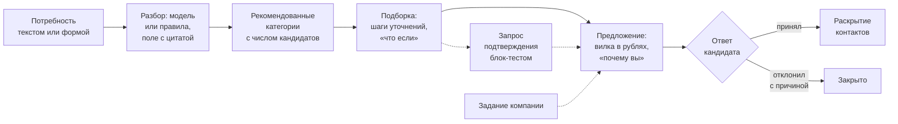
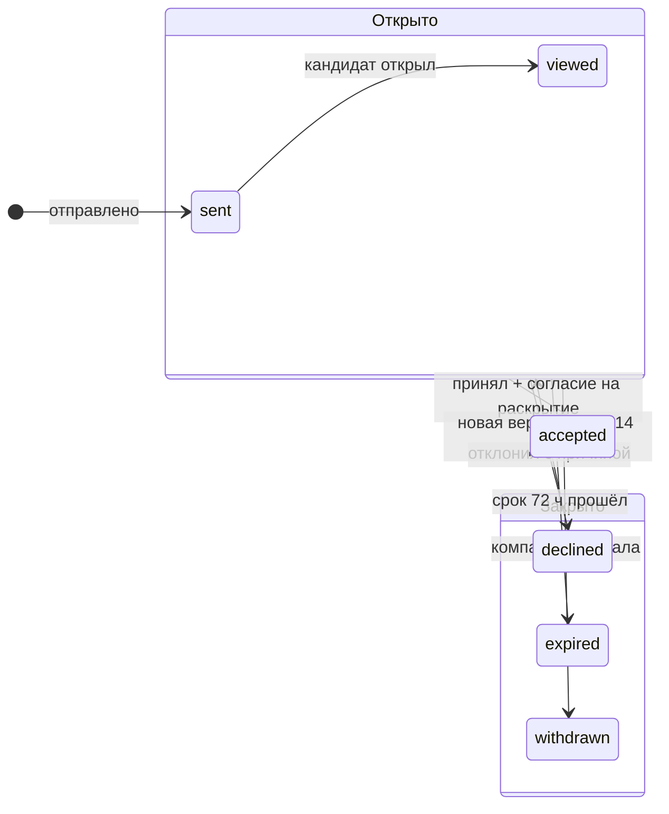

# Механика подбора и логика категоризации

Работодатель не ждёт откликов. Он описывает, кого ищет, и платформа показывает категории подтверждённых кандидатов, где такие люди
есть, и подборку из них с объяснением каждой позиции. Компания сама выходит на кандидата с предложением, где указаны вилка в рублях и
«почему вы». Контакты кандидата компания получает, только когда кандидат принял предложение.

| Что оценивается | Как выполнено |
|---|---|
| Автоматическая категоризация | категория — пара «специализация × грейд», и назначает её только решение теста (раздел 04); резюме и ФСП грейд не меняют |
| Сценарий выхода на контакт | потребность текстом → рекомендованные категории с числом кандидатов → подборка с историей уточнений и «что если» → предложение с вилкой и «почему вы» → ответ кандидата → раскрытие контактов; ещё три пути: задание компании, запрос подтверждения блок-тестом, отклик кандидата |
| Применимость для обеих сторон | работодателю не нужна вакансия; кандидат видит, что именно компания нашла в его профиле, и отвечает на условия, которые после отправки не меняются; второй уровень подборки показывает, подходит ли предложение кандидату |
| Обоснованность ранжирования | сначала грейд, потом число неподтверждённых обязательных навыков, внутри группы — аддитивный счёт с точным вкладом каждого компонента; параметры — версия 16 набора правил |
| Объяснимость | 3–5 сильнейших вкладов, у каждого есть источник (блок теста, квитанция ФСП, предпочтение); отдельно показаны пробелы, «проверить на собеседовании» и «без ФСП — позиция N» |

Всё описанное ниже взято из кода и данных. Ранжирование — `src/lib/server/matching/score.ts` (`needScore`, `fspRecord`) и
`rank.ts` (`rankForNeed`, `orderForNeed`). Потребность — `src/lib/server/needs/` (`parse.ts`, `recommend.ts`). Подборка —
`src/lib/server/shortlists/` (`service.ts`, `query.ts`, `cohort.ts`). Предложение — `src/lib/server/invitations/`. Задание,
подтверждение и отклик — `challenges/`, `confirmations/`, `applications/`. Параметры — `taxonomy/match-ruleset.json` (версия 16) и
`policies/*.json`. Модель данных — `docs/domain.md`, разделы 12–13.

## Категория кандидата

**Категория** — пара «специализация × грейд»: шесть специализаций на четыре грейда, справочник `CATALOG` версии `2026.10.3`
(`src/lib/server/assessments/contract/catalog.ts`). В подборке участвуют только **открытые** специализации: включённые в справочнике
и с выпущенным банком заданий (`openSpecializations`). В справочнике включены все шесть; закрыта специализация без выпущенного банка. Путь к категории
одинаков у всех кандидатов: опрос → подсказка грейда → заявленный грейд → тест → категория (раздел 04). Категорий у кандидата может
быть несколько — по одной на специализацию, каждая со своим тестом, своей политикой смены грейда и своим подтверждением с QR; кандидат
виден в подборках каждой (в демо — К-6, Middle Backend и Middle QA).

**Единственный владелец.** Таблицу `candidate_categories` пишет только модуль категорий (`src/lib/server/categories/publish.ts`,
`applyGradeDecisions`) и только по решениям теста. Остальной код читает категорию двумя функциями — `activeCategories` и
`categoryPredicate` (`categories/read.ts`). Поэтому каталог, подборка, счётчики, предложение и выгрузка видят одну и ту же категорию.

| Источник | Что он меняет | Чего не меняет |
|---|---|---|
| Решение теста на грейд | категорию и **подтверждённый стек** — навыки двух определяющих блоков грейда и язык практики, если кандидат писал программу на нём | — |
| Аннулирование решения или пересмотр по возражению | категорию: `resolveCategory` пересчитывает её по оставшимся действительным решениям | — |
| Резюме, достижения ФСП, публичные профили | выводы о навыках, подсказку грейда, порядок внутри категории | категорию: она не блокируется и не пропадает из выдачи (domain 12.4) |
| Блок-тест по запросу компании, решение задания | отдельное доказательство и свежесть профиля | категорию |
| Заявленный грейд | вводит кандидата в группу «грейд не подтверждён» и подписывает её: «указано кандидатом» | подтверждённый грейд |

**Кандидат без категории** не попадает в рекомендованные категории, в счётчики и в фильтры по категории. В подборке он виден
отдельной группой в конце, если его заявленный грейд называет категорию подборки, а в поиске по всей базе — с меткой «категория не
подтверждена» (domain 12.7). **Кандидат без ФСП** проходит тот же путь и в выдаче находится наравне с остальными: без ФСП он просто не
получает бонуса внутри категории, штрафа нет.

## Обратная механика: от потребности к контакту

### 1. Потребность

Работодатель пишет текст, например «Ищем Backend-разработчика Middle…», или заполняет форму. Вакансия для этого не нужна. Текст
разбирает модель (`extract`, схема `vacancy-extract/v2`) или детерминированные правила (`NEED_RULES_VERSION =
need-rules/3+…`, `needs/parse.ts`). Путь правил полный: без модели работодатель получает ту же форму с меткой «Без модели». К
каждому предложенному полю приложена **цитата** из текста. Работодатель подтверждает поля, а то, что он заполнил сам, имеет
приоритет над подсказкой.

- **Роль** берётся из заголовка или из строки со словом должности. Строка стека («Python, Airflow») роль не задаёт: инструмент — не
  должность. Если роль относится к одной специализации, она задаёт и специализацию. Роль, которую не проверяет ни один тест (data
  engineer, systems analyst), остаётся ролью без специализации — например, data engineer не превращается в backend по Python.
- **Грейд** — диапазон справочника: «Middle/Senior», «от Junior» (Junior–Senior), «до Middle» (Intern–Middle). Lead отображается
  в Senior.
- **Навыки** делятся на обязательные и желательные. Требования вне таксономии («Hugging Face») сохраняются под своим названием, и
  подборка помечает их «проверьте на собеседовании». Отрицание («Kotlin не требуется») требованием не становится.
- **Формат и регион** — регион определяется по справочнику городов в любом падеже («офис в Казани» — Республика Татарстан).
  **Вилка** — только в рублях в месяц, с обеими границами и налоговой базой. Текст с дискриминирующим требованием отклоняется
  (`422 text_blocked`).

### 2. Рекомендованные категории

`needCategoriesOf(form)` (`needs/recommend.ts`) — чистая функция формы.

| Основание | Что предлагается | Берётся в подборку по умолчанию |
|---|---|---|
| `form` / `role` | все грейды диапазона специализации формы; если специализации нет — первой открытой специализации роли | да |
| `neighbour_grade` | соседний грейд снизу и сверху от диапазона, с пояснением «грейд вне заявленного» | нет, только по выбору |
| `composite_role` | вторая специализация составной роли: у fullstack по умолчанию берётся Backend, а Frontend предлагается | нет, только по выбору |
| `skills` | для потребности без своей категории (`unsupported_role`, `closed`, `no_basis`): специализации, чьи блоки подтверждают обязательные навыки, с пометкой «N из M обязательных» | нет, только по выбору |

У каждой категории показано число кандидатов, которых видит эта компания: действующая категория по `categoryPredicate`, затем
`canShow` в каталоге компании. Отдельно указано, сколько из них имеют результаты ФСП, относящиеся к потребности. Числа меньше 5
показываются как «< 5» (`catalog_policy.small_count_threshold`). Если у потребности нет своей категории, это не ошибка: подборка
пуста и объясняет причину («для роли нет подтверждаемой категории», «категория закрыта»).

### 3. Подборка и история уточнений

Подборка хранит не карточки, а **запрос шага**: форму, категории (до 12) и фильтры — «только с ФСП», «принимают формат», «навыки
подтверждены тестом» (`shortlists/query.ts`). Каждое уточнение создаёт новый шаг `shortlist_revisions` со списком изменённых полей
(`{поле: {from, to}}`). Предыдущие шаги сохраняются, а уточнение, которое ничего не меняет, отклоняется. Отмеченные кандидаты при
уточнении не исчезают — у них появляется пометка «не проходит новое условие». При каждом открытии выдача пересчитывается, а
доступ к кандидату проверяется заново (`canShow`). Кандидат, которого компания больше не видит, показан строкой «кандидат больше
недоступен» без данных. Под выдачей есть строка «ещё M в соседней категории — грейд выше/ниже заявленного» с кнопкой расширения.

### 4. «Что если»

`whatIf` (`shortlists/service.ts`) меняет ровно **одно** условие: формат, грейд, навык, который должен быть подтверждён тестом,
«только с ФСП» или вилку. Ответ называет по псевдонимам, кто войдёт в выдачу и кто выпадет, и объясняет это только тем, что компания
видит на карточке: формат принимается или нет, у кандидата есть такая категория или только заявление, навык подтверждён или нет,
ФСП есть или нет. **По вилке** поимённого ответа нет, потому что ожидания кандидата скрыты (см. «Видимость и приватность»).
Ответ — агрегат когорты категории за сутки: «ваша вилка не ниже ожиданий у N из M».

### 5. Предложение

Предложение отправляет член компании, которая прошла политику допуска (раздел 11). В нём: название, описание, вилка «от–до»
**только в рублях** (иначе `422 salary_not_rub`), формат, способ связи с компанией, срок ответа и **«почему вы»** — от одного до
пяти пунктов (`WHY_YOU_MIN`, `WHY_YOU_MAX`, `invitations/terms.ts`). Вакансию указывать необязательно. Пункт без источника не
сохраняется. Источник — блок теста действующей категории, квитанция ФСП, выданная этой компании, подтверждённый блок-тест,
решение задания, заявленный навык или предпочтение кандидата. При отправке из подборки пункты переходят в предложение из её
объяснения, вместе с потребностью. Сервис проверяет каждый источник заново: пункт, показанный на странице, не считается
доверенным только потому, что он там есть.

Отправленные условия **неизменны**. Любая правка создаёт новую версию, кандидат видит отличия и отвечает на неё отдельно. Если вилка
ниже любой предыдущей версии, это отмечается (`salary_lowered`), и кандидат видит «ниже предыдущего предложения этой компании».
Повторное предложение после отказа возможно не раньше чем через 14 дней и не больше двух раз (`invitation_policy`: `reopen_cooldown_days`
14, `max_reopens` 2). Кандидату без подтверждённого грейда тоже можно сделать предложение: в версии условий записывается
`category = null`, и обе стороны это видят.

### 6. Ответ, статусы и раскрытие контактов

Срок ответа — 72 часа (`invitation_policy.response_window_hours`). Причина отказа обязательна и выбирается из списка: зарплата,
формат, стек, «не ищу», другое. **Контакты кандидата** — ФИО и почта как минимум, а телефон, Telegram и резюме по выбору кандидата
— компания получает только после принятия. Принятие, событие согласия и запись в журнал раскрытий создаются в одной транзакции.
Если кандидату 14–17 лет, принятие ждёт согласия представителя. До принятия компания видит только псевдонимную карточку. Принятие
открывает процесс найма. Этапы и исход сообщают обе стороны, и из молчания исход не выводится (domain 13.7).

### Другие пути к контакту

| Путь | Как работает | Где в коде |
|---|---|---|
| **Задание компании** | короткая задача (до 30 минут) с видимой вилкой и целью. Задание `challenge.deliver` раз в 24 часа доставляет её кандидатам нужной категории, которых видит компания: не больше 50 за прогон и не чаще одного задания кандидату в 7 дней. Через 3 дня без открытия — одно напоминание. Компания видит решения под псевдонимами и приглашает прямо из решения: пункт «почему вы» получает источник `challenge_solution`. Кандидат может отозвать решение в любой момент | `challenges/`, `policies/challenge_policy.json` |
| **Запрос подтверждения** | из карточки, подборки или предложения работодатель просит кандидата пройти блок-тест: 4 задания одного блока на грейде категории, только из резервных классов. Можно запросить блок вне определяющих блоков категории кандидата, если квота блока в плане грейда не меньше 3. Кандидат отвечает добровольно, в течение 14 дней, и отказ ни на что не влияет. Результат — отдельное доказательство и пункт «почему вы»; категория от него не меняется | `confirmations/requests.ts` (`REQUEST_ANSWER_DAYS = 14`) |
| **Отклик кандидата** | вторичный путь: отклик на собственную опубликованную вакансию компании платформы, только с 18 лет. Отклик сразу раскрывает контакты этой компании с согласия кандидата; к отклику сохраняется снимок соответствия. Компания отказывает или отправляет предложение, и тогда отклик получает статус `invited` | `applications/service.ts` |
| **Спрос — кандидату** | в кабинете «Категория и грейд» кандидат видит агрегат: сколько действующих потребностей компаний подходят под его категорию, медиану их вилок и как часто встречается каждый навык. Конкретные потребности и компании не раскрываются; числа ниже порога — «< N» | `candidates/need-demand.ts`, `candidates/demand.ts` |

## Ранжирование подборки

### Порядок: грейд, покрытие, счёт

`orderForNeed` (`matching/rank.ts`) сортирует кандидатов по ключам в таком порядке:

1. **Грейд.** Все кандидаты с действующей категорией подборки идут выше всех из группы «грейд не подтверждён», какой бы ни была разница в
   счёте.
2. **Покрытие обязательных навыков.** Сначала кандидаты, у которых все обязательные навыки подтверждены тестом, ФСП или платформой.
   За ними — по числу неподтверждённых N из M: чем N меньше, тем выше.
3. **Составная роль** (fullstack). Кандидат с категориями в обеих специализациях роли выше остальных из той же группы покрытия.
4. **Счёт** внутри группы, по убыванию.
5. **Почти равные.** Если счёт отличается от счёта первого в группе меньше чем на `nearTie` = 0,01, порядок определяет смысловая
   близость к тексту потребности, затем сила профиля, затем id. Смысловая близость сама счёт не меняет и не переносит кандидата через
   границу группы. Без модели почти равные упорядочиваются по силе профиля.

Неподтверждённый обязательный навык помечен тем, что есть вместо подтверждения: `public_profile` — только проверенный публичный
профиль, `claimed` — заявлено, `missing` — в прочитанном профиле навыка нет, `unknown` — профиль сейчас не прочитан. Отсутствие
навыка и отсутствие данных о нём — разные вещи.

### Счёт: два уровня, один знаменатель

Счёт — сумма вкладов компонентов:

**вклад = вес × значение / знаменатель**, где знаменатель — сумма весов компонентов, о которых спрашивает потребность. Он один для
всех кандидатов этой потребности. Значение каждого компонента лежит в [0, 1], поэтому счёт тоже в [0, 1], а вклад каждого
компонента на карточке — точное число, а не доля «примерно».

| Уровень | Компонент | Вес (v16) | Значение | Не считается, когда |
|---|---|---|---|---|
| Соответствие потребности | `required` | 0,40 | среднее значение обязательных навыков по лучшему основанию (таблица ниже) | в потребности нет обязательных навыков |
| | `nice` | 0,10 | то же для желательных навыков | нет желательных |
| | `format` | 0,10 | формат принимается и регион совпадает (или работа удалённая) — 1; готов к переезду — 0,5; другой формат или регион — 0; формат или регион кандидата неизвестен — 0,5, не штраф | в потребности не указан формат |
| Сила подтверждённого профиля | `test` | 0,20 | результат теста по блокам (ниже); без категории подборки — 0 | — |
| | `fsp` | 0,10 | запись ФСП (ниже); без ФСП — 0 | работодатель указал, что ФСП для потребности не важна (`fsp_relevant = false`) |
| | `freshness` | 0,10 | `0,5^(дней / 365)` с последнего подтверждённого действия | — |

Каталог без потребности ранжируется только по силе профиля: знаменатель равен 0,40. Зарплатные ожидания в счёт, который видит
компания, не входят.

**Ценность навыка по основанию** (`readSkill`; из нескольких оснований берётся лучшее). Правило одно для подборки и для соответствия
вакансии (правила v16, параметры `skill`):

| Основание | Значение | Подтверждает навык для покрытия |
|---|---|---|
| Стек действующей категории, подтверждённый тестом (`testedSkillValue`) | 1 | да |
| Прямое подтверждение ФСП или платформой (блок-тест) | ценность полосы силы: слабая 0,4, средняя 0,7, сильная 1 | да |
| Проверенный публичный профиль | 0,6 × полоса | нет |
| Заявлено или выведено из резюме, тест кандидата этот навык **не проверяет** (ClickHouse, Kafka) | 0,5 × полоса, «заявлено, тестом не проверяется» | нет |
| Заявлено или выведено из резюме, тест кандидата этот навык **проверяет** и не подтвердил | 0,3 × полоса, «заявлено» | нет |

Ниже всего ценится то, что тест мог подтвердить, но не подтвердил. Пока кандидат его не прошёл, его заявление стоит меньше, чем
заявление о навыке, который платформа не проверяет вовсе. Сильное заявление при этом остаётся выше слабого.

**Результат теста по блокам** (`readTest`) берётся из решения, на котором держится категория. Для каждого блока считается запас над
порогом в расчёте на одно задание:

`запас блока = (S − C) / (20 · n) × n / (n + 3)`,

где `S` — сумма баллов, `C` — сумма оценок Angoff поданных заданий (обе в двадцатых долях), `n` — число заданий блока. Множитель
`n / (n + 3)` уменьшает вес короткого блока: блок из одного задания учитывается с весом ¼. Затем запасы блоков усредняются с весом
`n`, причём блоки, подтверждающие навыки потребности, весят вдвое больше. Итог: `значение = 0,5 + 2 × средний запас`, ограниченное
отрезком [0, 1]. Значение 0,5 означает результат ровно на пороге. Если решение без блоков, ставится 0,5 с причиной
`test_result_missing`.

### Запись ФСП: соревнования и призовые с учётом профиля дисциплины

По ответу заказчика на сессии вопросов 2026-10-06 достижения ФСП влияют **только на порядок внутри категории**, а не на грейд
(`fspRecord`, `need.fsp`). Учитываются официальные результаты, которые сейчас в силе. Командный результат запасного или тренера в
зачёт кандидату не идёт.

По письменному ответу организаторов 2026-10-07 все дисциплины одинаково приоритетны, но учитывать можно актуальность направления:
специалист по ИБ на соревнованиях по ИБ релевантнее, чем на соревнованиях по робототехнике. Поэтому соревнование дисциплины,
**профильной для специализации подборки**, весит 1, соревнование любой другой дисциплины — 0,5. Ноль не ставится: это всё равно
подтверждённый результат. Карта «дисциплина → специализации» лежит в правилах соответствия (`need.fsp.disciplines`), у каждой строки
есть обоснование:

| Дисциплина | Профильна для |
|---|---|
| алгоритмическое программирование | Backend, Frontend, Mobile, Data/ML — всех разработческих специализаций |
| продуктовое программирование | Backend, Frontend, Mobile, Data/ML, DevOps — специализации участников команды по правилам проекции ФСП |
| программирование БАС, робототехника | Data/ML — техническое зрение и управление |
| информационная безопасность | Backend, DevOps — безопасность веб-приложений и инфраструктуры |

Для QA профильной дисциплины нет, поэтому все соревнования QA-кандидата весят одинаково, 0,5. В каталоге без потребности
профиль берётся по категории, по которой читается сила профиля.

`N` — сумма весов разных соревнований кандидата, `M` — сумма весов тех из них, что закончились победой или призом, личным или
командным:

**fsp = 0,3 · (1 − 2^(−N/1,5)) + 0,7 · (1 − 2^(−M/0,5))**

Словами: 30 % значения даёт участие, 70 % — результативность. Полупериоды — прежние 3 и 1, умноженные на 0,5. Поэтому соревнование
непрофильной дисциплины считается ровно как любое соревнование в версии 13, а профильное — вдвое. Обе части насыщаются, и значение
всегда меньше 1.

| N / M | 1 / 0 | 3 / 0 | 5 / 0 | 10 / 0 | 1 / 1 | 3 / 1 | 2 / 2 | 5 / 2 | 6 / 3 |
|---|---|---|---|---|---|---|---|---|---|
| `fsp`, все профильные | 0,11 | 0,22 | 0,27 | 0,30 | 0,64 | 0,75 | 0,84 | 0,93 | 0,97 |
| `fsp`, все непрофильные | 0,06 | 0,15 | 0,21 | 0,27 | 0,41 | 0,50 | 0,64 | 0,73 | 0,84 |

Одно призовое место, даже непрофильное, весит больше любого числа участий: 0,7 × (1 − 2^(−0,5/0,5)) = 0,35 > 0,3. Схема правил
отказывает параметрам, которые это нарушают. При прочих равных профильное соревнование не ниже непрофильного. Вес `fsp` (0,10) меньше
веса `test` (0,20) и `required` (0,40), поэтому ФСП поднимает кандидата внутри категории, но не перекрывает результат теста и
соответствие потребности. Уровень соревнования и разряды ЕВСК — отдельный факт профиля, а не множитель. Командная победа входит в `M`,
но навык не подтверждает. Подтверждение навыка фактом ФСП — отдельная ось: оно учитывается в `required` и `nice`, и бонус его не
повторяет. Объяснение в карточке: «5 соревнований ФСП, из них 2 призовых, по профилю специализации — 2». Инварианты закреплены
тестами `src/lib/server/matching/need.test.ts`: например, «две победы выше пяти участий без призов» и «профильное соревнование выше
непрофильного при прочих равных».

**Свежесть** отсчитывается от самого позднего подтверждённого действия: назначения категории, действующего результата блок-теста или
отправленного решения задания. При полураспаде 365 дней профиль, подтверждённый 30 дней назад, получает 0,95, полгода назад — 0,71, год
назад — 0,5. Открытие и доставка задания свежесть не меняют.

### Группа «грейд не подтверждён»

Заказчик на сессии вопросов попросил не скрывать кандидатов без подтверждённого грейда, чтобы они не выпадали из оборота, но и не
смешивать их с подтверждёнными. Решение (правила v13, domain 13.10): в группу входит кандидат без действующей категории
специализации подборки (теста не проходил, не прошёл или результат не определён), если его действующее заявление называет категорию
подборки. Группа стоит **после всех** подтверждённых. Она не входит ни в число кандидатов категории, ни в рекомендованные категории,
ни в метрики подборки. Внутри группы действует тот же порядок. Заявленный грейд служит только фильтром и подписью «указано
кандидатом». Заявленный навык, который проверяет тест заявленной категории, получает нижний потолок 0,3. Результат теста — 0, ФСП
и проверенные профили учитываются как обычно. Кандидат с категорией другого грейда той же специализации в группу не попадает — он
показан в строке соседней категории.

### Объяснение позиции

Каждая карточка подборки (`shortlist-row.svelte`) показывает:

- **почему подходит** — от 3 до 5 сильнейших положительных вкладов с числом и источником: «SQL, многопоточность —
  подтверждены тестом», «результат теста Backend Middle», «формат подходит», «подтверждено 40 дн. назад»,
  «2 соревнования ФСП, из них 1 призовое, по профилю специализации — 2» (`test_block`, `fsp_fact` — квитанция результата, `preference`, `declared_skill`);
- **разложение счёта** — вклад каждого компонента и сумма по уровням;
- **пробелы** — обязательные навыки без какого-либо основания; **проверить на собеседовании** — навыки, которые подтверждены только словами
  кандидата, и требования вне таксономии;
- **без ФСП — позиция N** — место, которое кандидат занял бы, если бы у него не было результатов ФСП, при неизменных остальных
  кандидатах. Результат ФСП может подтверждать и обязательный навык, поэтому без ФСП может измениться и группа покрытия;
- **подходит ли предложение кандидату** (`offerFit`, `shortlists/cohort.ts`) — по формату и региону: «да», «переезд», «нет» или
  «неизвестно», без значений.

Над выдачей показана доля кандидатов без ФСП в первой десятке в сравнении с их долей во всей выдаче. Это помогает увидеть, не
вытесняет ли бонус ФСП остальных кандидатов.

## Пример насквозь

Числа ниже посчитаны по формулам набора правил 14.

**Потребность.** «Ищем Backend-разработчика уровня Middle в команду платежей. Обязательно: Python, SQL, многопоточность. Будет плюсом:
Kafka. Гибрид, офис в Казани. 250–320 тыс. ₽ до вычета НДФЛ». Правила разбора дают роль `backend` (специализация Backend), грейд
Middle–Middle, обязательные навыки `python`, `sql`, `multithreading`, желательный `kafka`, формат `hybrid`, регион 16, вилку в
рублях. Рекомендованные категории: Backend Middle — по умолчанию; Backend Junior и Backend Senior предлагаются как соседние. У каждой
показано число кандидатов и сколько из них с ФСП. Все шесть компонентов применимы, знаменатель 1,0.

| | Кандидат А | Кандидат Б | Кандидат В |
|---|---|---|---|
| Категория | Backend Middle, 40 дней назад, практика на Python | Backend Middle, 200 дней назад, практика на Go | нет; заявил Backend Middle |
| Блоки решения (`n`, `S`/`C` в двадцатых) | `be.db` 4, 68/52; `be.concurrency` 3, 45/36; `be.code` 1, 17/15 | `be.db` 4, 60/52; `be.concurrency` 4, 62/48; `be.code` 1, 16/15 | — |
| Python / SQL / многопоточность | тест / тест / тест | **заявлено** (сильно, 0,3) / тест / тест | заявлено 0,3 / 0,3 / 0,21 |
| Kafka | из резюме, средняя полоса: 0,7 × 0,5 = 0,35 | нет | нет |
| ФСП | 2 соревнования по алгоритмическому программированию, 1 призовое: 0,71 | 5 соревнований, 2 призовых по алгоритмическому программированию и 3 участия в робототехнике: 0,90 | нет: 0 |
| `required` / `nice` / `format` | 1 / 0,35 / 1 | 0,77 / 0 / 1 | 0,27 / 0 / 1 |
| `test` / `fsp` / `freshness` | 0,685 / 0,706 / 0,927 | 0,649 / 0,897 / 0,684 | 0 / 0 / 0 |
| **Счёт** | 0,40 + 0,035 + 0,10 + 0,137 + 0,071 + 0,093 = **0,836** | 0,307 + 0 + 0,10 + 0,130 + 0,090 + 0,068 = **0,695** | 0,108 + 0 + 0,10 = **0,208** |
| Группа | подтверждён, все обязательные навыки закрыты | подтверждён, 1 из 3 обязательных не подтверждён (Python — «заявлено») | «грейд не подтверждён» |
| Позиция / без ФСП | 1 / 1 | 2 / 2 | после всех подтверждённых |

Запас теста А: у `be.db` (16 / 80) × 4/7 = 0,114, у `be.concurrency` (9 / 60) × 3/6 = 0,075, у практики (2 / 20) × 1/4 = 0,025.
Первые два блока подтверждают навыки потребности и весят вдвое: (8 · 0,114 + 6 · 0,075 + 1 · 0,025) / 15 = 0,093. Отсюда
`test` = 0,5 + 2 · 0,093 = 0,685. Алгоритмическое программирование профильно для Backend, робототехника — нет: у А `N` = 2,
`M` = 1, и `fsp` = 0,3 · (1 − 2^(−2/1,5)) + 0,7 · (1 − 2^(−1/0,5)) = 0,181 + 0,525 = 0,706; у Б `N` = 2 + 3 · 0,5 = 3,5, `M` = 2, и
`fsp` = 0,241 + 0,656 = 0,897. У Б больше результатов ФСП, но Б ниже А: его Python подтверждён только словами, а тест Б проверял
практику на Go. Покрытие стоит выше счёта, и бонус ФСП это не перекрывает. Карточка А объясняет позицию так: «Python, SQL,
многопоточность — подтверждены тестом (0,40)», «результат теста Backend Middle (0,137)», «формат подходит (0,10)», «подтверждено 40
дн. назад (0,093)», «2 соревнования ФСП, из них 1 призовое, по профилю специализации — 2 (0,071)». Kafka вынесена в «проверить на собеседовании».

**Дальше.** Работодатель спрашивает «что если удалённо»: ответ называет кандидатов, которые войдут в выдачу или выпадут из неё, по
формату на карточке. Затем он запрашивает «что если вилка 280–350 тыс.» и получает агрегат вроде «не ниже ожиданий у 10 из 15»
(числа кратны 5). Работодатель отмечает А и отправляет ему предложение: вилка 250–320 тыс. ₽ до вычета НДФЛ, гибрид, контакт
компании и «почему вы» из трёх пунктов объяснения с источниками. У Б он просит подтвердить блок `be.api` или отправляет задание. А видит
компанию с меткой проверки, условия и что именно компания увидела в его профиле. А принимает предложение и выбирает поля раскрытия —
только после этого компания видит его ФИО и почту.

## Соответствие вакансии

Когда в предложении или поиске есть вакансия, а также в ленте кандидата «Вакансии для меня», используется вторая функция —
`matchScore` (`matching/score.ts`, domain 13.4). Её считают в обе стороны: работодатель ранжирует кандидатов под вакансию, кандидат
видит своё соответствие вакансиям. Веса v16: обязательные навыки 0,45, специализация роли 0,25, грейд 0,20, желательные навыки, доверие,
зарплата, смысловая близость и реранкер — по 0,10. Компонент, который не удалось вычислить, в сумму не входит, и веса остальных
нормируются: неизвестное не штрафуется как несоответствие и уходит в «проверить на собеседовании». Реранкер — отдельный компонент
со своим весом, он не заменяет счёт. Грейд и специализацию функция читает из действующей категории.

Навык, подтверждённый тестом, весит в соответствии вакансии столько же, сколько в подборке: одно правило (`testedSkill`) и одна
ценность (`testedSkillValue` = 1, правила v15). Навык стека действующей категории покрывает требование вакансии и идёт в доверие
наравне с подтверждением ФСП; если тот же навык есть в резюме, засчитывается большее, при равенстве — тест. Тест от расчёта
доказательств не зависит: кандидат только с тестом — без резюме и ФСП — получает на вакансии своего стека покрытие навыков и
доверие, входит в пул подтверждённых, а объяснение называет источник «тест» с категорией и блоком. До v15 такой кандидат получал на
любой вакансии Backend Middle одно и то же соответствие 0,409 — только за роль и грейд.

Навык из резюме, ФСП, платформы и публичного профиля стоит на вакансии столько же, сколько в подборке: та же функция `readSkill` и
та же таблица ценности по основанию (правила v16). До v16 соответствие вакансии засчитывало заявленный навык полной полосой, как
подтверждённый, и громкое резюме покрывало требование наравне с ФСП. Пример — вакансия Backend Middle–Senior с обязательными Go и
PostgreSQL, кандидат с категорией Backend Middle, совпадающей зарплатой, модели выключены: оба навыка подтверждены ФСП с сильной
полосой — 0,917; оба только заявлены в резюме с той же полосой — было 0,833 (разница — одно доверие), стало 0,608: Go проверяет тест
кандидата (язык практики Backend) — 0,3 полосы, PostgreSQL тестом не проверяется — 0,5. Объяснение называет основание каждого
навыка: «подтверждено ФСП», «публичный профиль», «указано кандидатом, тест не подтвердил». Доверие и пул подтверждённых — прежние:
их дают только тест, ФСП и платформа.

## Режимы модели

| Режим (`docs/models.md`, «Три режима») | Разбор текста потребности | Что видит работодатель |
|---|---|---|
| **Внешняя модель по API** (`LLM_RUNTIME=api`, демонстрационный стенд) | модель, у каждого поля цитата; если модель не ответила — правила для этого текста | до отправки — подпись «текст разбирает внешняя языковая модель», у результата — метка с именем модели |
| **Своя модель** (`LLM_RUNTIME=vllm`, Qwen3-8B-AWQ на одной видеокарте) | то же, текст не покидает платформу | метка «Своя модель» |
| **Без модели** (нет ключа или адреса, или модель выключил администратор) | детерминированные правила дают ту же форму, `mode = rules` | метка «Без модели» и уведомление об упрощённом режиме |

Смысловую близость считает собственный эмбеддер платформы на CPU, и от режима языковой модели она не зависит. Если эмбеддер
недоступен, почти равные упорядочиваются по силе профиля, а поиск идёт только по словам. Реранкер в подборке не используется. В
любом режиме категория, порядок групп, счёт и объяснение остаются теми же: от моделей они не зависят (`contracts.md` 3.5). Модель
меняет только то, как читается текст потребности, и порядок почти равных кандидатов. Фиктивного ответа вместо модели продукт не
подставляет.

## Чего система не делает

- **Не отказывает и не приглашает сама.** Предложение отправляет человек из компании, отказывает кандидат. Автоматически
  срабатывают только истечение срока ответа и отзыв предложения, когда компания приостановлена или вакансия закрыта. Задание компании
  система доставляет сама, но это задача, а не приглашение.
- **Не выводит грейд** из резюме, ФСП или публичных профилей и не понижает подтверждённый грейд по результату другого теста.
- **Не показывает внешние вакансии.** Вакансии на платформе — только собственные вакансии компаний платформы: их видит кандидат в
  ленте, на них он откликается, и только свою опубликованную вакансию компания может указать в предложении.
- **Не оценивает поимённо**, подходит ли вилка кандидату со скрытыми ожиданиями.

## Видимость и приватность в выдаче

- **Псевдоним вместо личности.** Компания видит кандидата под псевдонимом HMAC(`candidate_id`, `company_id`), который у каждой
  компании свой, — сопоставить кандидатов между компаниями нельзя. ФИО и контакты компания получает только после принятия
  предложения или отклика.
- **`canShow` при каждом показе** — в подборке, счётчиках, «что если», задании и отправке предложения. Это одна функция, она отсекает
  скрывшихся кандидатов, отозвавших согласие на каталог, заблокировавших компанию и несовершеннолетних без подходящей вакансии.
- **Зарплатные ожидания скрыты.** Поимённо их не показывают и в счёт не включают. Для вилки есть только агрегат по фиксированной
  когорте категории. Ожидания и вилка приводятся к интервалам: 25 000 ₽ до 300 000, затем 50 000 ₽ до 600 000, затем 100 000 ₽. Числа
  округляются вниз до кратного 5, а снимок когорты делается раз в сутки отдельно для каждой компании. Поэтому серия запросов с
  разными вилками или запросы до и после ухода одного кандидата не позволяют вычислить его ожидания: это проверяет
  `tests/integration/shortlists.test.ts`. Кандидат 18+ может открыть свои ожидания сам.
- **Малые числа** в счётчиках категорий и спросе показываются как «< 5».

## Как оценивали

Процедура, наборы данных и ограничения описаны в разделе 06. Коротко: синтетические кандидаты и потребности с независимой разметкой
(методика v3, `tools/eval/README.md`). Продукт ранжирует фактическим путём подборки во временной базе, базовый вариант — поиск по
тому же тексту.

Продукт настраивался на dev-части, отложенную часть (holdout) открыли один раз — 2026-10-08, ревизия `bfb640e5363f`, правила
соответствия 16, разбор правилами, без смысловой близости (`tools/eval/reports/holdout/journal.json`). Dev-прогон на той же ревизии
повторяет прежние dev-числа до четвёртого знака. Отчёты: dev — `tools/eval/reports/synthetic-resumes-v3-dev-rules_only.json`
(29 потребностей с подходящими кандидатами, пул — 198 людей с подтверждённой категорией), holdout —
`tools/eval/reports/holdout/synthetic-resumes-v3-holdout-rules_only-20261008T151034Z.json` (27 потребностей, пул — 196 людей).
В скобках — поиск по тому же тексту.

| Мера | Dev | Holdout |
|---|---|---|
| nDCG@10, подбор целиком | 0,657 (0,324) | 0,612 (0,487) |
| Разность nDCG@10 с поиском, 95 % интервал | 0,333 [0,189; 0,450] | 0,126 [−0,037; 0,272] |
| Precision@10 | 0,224 (0,162) | 0,207 (0,185) |
| MRR | 0,691 (0,314) | 0,583 (0,538) |
| Recall@10 | 0,833 (0,542) | 0,770 (0,656) |
| nDCG@10, сортировка одного допустимого набора (поиск по тем же требованиям) | 0,735 (0,476), 26 потребностей | 0,750 (0,586), 23 потребности |
| nDCG@10 подборки без ФСП | 0,610 | 0,589 |
| Доля без ФСП в первой десятке (во всей выдаче) | 0,44 (0,53) | 0,66 (0,68) |
| Проверки ТЗ: позиции без категории / несовпадение категории / вне категорий потребности / подтверждённый навык есть на деле | 0 / 0 / 0 / 1,000 | 0 / 0 / 0 / 1,000 |

**На holdout подбор хуже, чем на dev, и порог не пройден.** Подборка по-прежнему выше поиска в среднем (+0,126 nDCG@10, выигрыш
на 19 потребностях из 27, проигрыш на 7), но нижняя граница интервала разности −0,037 — ниже заранее зафиксированного порога ≥ 0.
По Precision@10 и MRR интервалы разности с поиском тоже захватывают ноль. Поиск по тексту на holdout заметно сильнее, чем на dev
(0,487 против 0,324), подборка слабее (0,612 против 0,657). Правило ранжирования, которое мерит оценка (`rankForNeed`), после
прогона не менялось: позже менялись только подпись у почти равных, путь кандидата к соответствию и блокировки пересчёта, порядок
выдачи — тот же. Одна правка после прогона касается входа оценки: разбор текста потребности правилами читает сумму без названной
валюты как рубли (`938781f9`), и вилка такой потребности теперь попадает в форму; на этой ревизии holdout не перезапускался.
Holdout открыт один раз, и его числа — итоговая мера, а не повод подгонки.

Что даёт каждая часть механики (абляции того же прогона):

- **порядок внутри допустимого набора** держится: на тех же кандидатах подборка сортирует лучше поиска по тем же требованиям —
  +0,163 [0,043; 0,278] nDCG@10 на holdout (+0,259 на dev);
- **проигрыши — в составе подборки, а не в порядке.** В четырёх из семи проигрышей в первой десятке подборки нет ни одного
  подходящего по рубрике человека, а поиск по тексту их находит: ручное тестирование Middle (две потребности), автотестирование
  Middle, фулстек Senior. В трёх из них подборка короче десяти, то есть подходящих людей в ней нет вовсе: по ТЗ она берёт только
  категорию нужного грейда, подтверждённую тестом, а поиск ранжирует всех по тексту резюме. То же на dev было у Backend
  (0,298 против 0,237 у поиска, 4 фулстек-потребности): подходящие фулстек-разработчики подтвердили Backend только на Middle, а
  категории каталога бэкенд и фулстек не различают;
- **ФСП** — +0,023 [−0,016; 0,084] nDCG@10 на holdout (+0,046 [−0,003; 0,105] на dev): вклад положительный, но не доказан;
- **смысловая близость** в этих прогонах не участвовала (эмбеддер выключен), её вклад не измерен.

Разрезы holdout (nDCG@10 подборки против поиска): Frontend 0,901 против 0,795, Data/ML 0,689 против 0,370, автотестирование
0,541 против 0,373, Backend 0,454 против 0,437, фулстек 0,515 против 0,492, ручное тестирование 0,358 против 0,481 — единственная
роль, где подборка проигрывает. Мир и разметка синтетические (раздел 06): числа показывают, что продукт читает тест и ФСП так, как
задумано, а не качество подбора на реальных людях.

У жюри свой закрытый набор пар «вакансия — кандидат». Его можно прогнать без учётных записей, засева и данных приложения в режиме
оценки жюри — нужны PostgreSQL с правом `CREATEDB` (временная база прогона) и `docparse`, подъём одной командой
`docker compose up -d --wait postgres docparse-gateway`: `pnpm eval:jury-run --input <файл>.jsonl`, затем `pnpm eval:jury-metrics`
по разметке жюри (`docs/contracts.md`, 10.1; команды с нуля и ожидаемый вывод на образце — `tools/eval/README.md`, «Режим оценки
жюри»). Выход — обе группы, которые показывает продукт: подборка (категория из подтверждённого теста) и после неё группа «грейд не
подтверждён», с разложением и основаниями по каждой потребности, кого продукт не показал и почему, сводка входа (сколько кандидатов
с решениями тестов и с категорией) и лист слепой разметки первых десяток продукта и базового варианта. Без решений тестов во входе
подборка по ТЗ пуста — прогон говорит это прямо, а не показывает нули как качество ранжирования.
В продукте то же сравнение доступно работодателю на странице подборки — «Оцените подбор»: слепое чередование
первой десятки подборки и поиска по ключевым словам, Precision@10 каждой системы.
