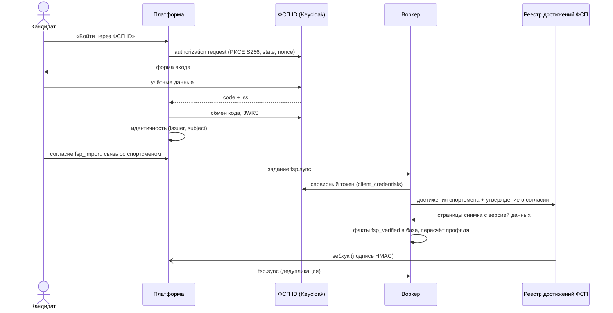

# Интеграция с реестром ФСП

Доступ к API и данным реестра ФСП в рамках хакатона не предоставлялся, структура данных не выдавалась. Поэтому интеграция
построена на собственном контракте `fsp-achievements/v1` (JSON Schema `contracts/fsp-achievements/v1.schema.json`) и на
стандартном OIDC для ФСП ID, а на стенде оба интерфейса обслуживает имитатор `fsp-mock`. Ядро продукта знает только интерфейсы
адаптеров; переход на реальные системы ФСП меняет реализацию адаптера и настройки, а не модули продукта.

## Какие сведения о достижениях получаем и почему

| Сведение | Поля | Зачем |
|---|---|---|
| Спортсмен | ID участника ФСП (`fspId`), ФИО, год рождения, регион, состав сборной, аккаунты на платформах соревнований с рейтингом | сверка с профилем; ФИО не записывается поверх заполненного кандидатом, год рождения — только если дата не указана |
| Результат | соревнование, место из скольких, баллы и решённые задачи, команда и роль в ней, персональная специализация в команде, награда, выполненная норма ЕВСК, статус (`official` · `preliminary` · `annulled`) | основной проверяемый факт: что и на каком уровне человек показал |
| Соревнование | дисциплина, уровень (от муниципального до чемпионата мира), этап (отбор · финал), очное или онлайн, номер ЕКП, даты, ссылка на протокол | вес результата и метка «подтверждено очно» |
| Разряд | разряд, дисциплина, дата и приказ присвоения, соревнование-основание | присвоенный разряд отдельно от выполненной нормы |

Три вида сведений не смешиваются: присвоенный разряд, результат и выполненная норма ЕВСК — разные факты. Предварительный
результат хранится, но в расчёт не входит; аннулированный выводится из профиля. Неизвестное значение перечисления (новый уровень
соревнования, новая роль в команде) не ломает импорт: поле получает `unknown`, исходная строка сохраняется, а правила, которым это
поле нужно, такую запись не используют.

**Как показывается работодателю.**

- Все факты ФСП получают уровень доверия `fsp_verified`. Какие навыки из них следуют, решают версионированные правила проекции
  (дисциплина, уровень, роль в команде); адаптер навыков не выводит.
- В каталоге карточка показывает результаты обобщённо — дисциплина, уровень соревнования, сезон, группа результата, формат;
  точное соревнование и место — если совершеннолетний кандидат открыл их сам, или компании после раскрытия.
- У каждого показанного факта — **квитанция проверки**: подписанное платформой (Ed25519) заявление о факте с публичным
  идентификатором. Работодатель проверяет её по `GET /api/v1/verify/{handle}` или на странице `/verify/{handle}` без раскрытия
  личности; открытые ключи подписи — `GET /.well-known/receipt-keys.json`. Ссылки на запись источника и хэш снимка входят в
  заявление солёными обязательствами, поэтому две компании не могут связать квитанции одного кандидата, сравнив их.
- Метки результата разведены: **«Подтверждено очно»** — только конкретный очный личный результат или командный с переданной
  персональной специализацией; иначе **«Результат подтверждён ФСП»** с форматом и границами. Метка относится к результату, не
  переносится на категорию и не подтверждает грейд.
- По дисциплине считается **уровень ФСП** L1–L5 — фасет поиска; в грейд он не пересчитывается.
- Кандидатам 14–17 лет квитанции не выпускаются, всё о них показывается на уровне «дисциплина + уровень соревнования».

**Что подтверждает и чего нет.** Квитанция называет, что факт подтверждает на своём уровне показа, и что он **не**
подтверждает — тексты шаблона версии таксономии: владение конкретным языком, коммерческий опыт; у командного результата — личный
вклад в командное решение; у запасного, тренера и участника с непереданной ролью — оговорки по роли. Квитанция демонстрационного стенда несёт под подписью
`source_simulator: true`, и страница проверки показывает «Источник — имитатор ФСП».

## Связь профиля с ID участника ФСП

- **Вход.** Собственный OIDC-клиент приложения к ФСП ID: Authorization Code + PKCE S256, `state` и `nonce` обязательны, `iss` в
  ответе авторизации сверяется точным сравнением, ID-токен проверяется по JWKS провайдера (RS256, PS256, ES256), `aud`, `exp`,
  `auth_time`. ID-токен не хранится. Дата рождения и телефон в claims ФСП ID не передаются — дата рождения собирается при
  регистрации.
- **Совместимость с Keycloak.** ФСП ID работает на Keycloak (`sso.fsp-russia.ru/realms/fsp`). Клиент знает только стандарт OIDC
  и сверяет discovery по используемым значениям, а не по совпадению списков. Интеграционный тест
  `tests/integration/keycloak-oidc.test.ts` поднимает настоящий Keycloak 26.8 (`quay.io/keycloak/keycloak:26.8.0`) с realm `fsp`
  и проходит весь поток без изменений клиента: discovery, запрос авторизации с PKCE S256, `state` и `nonce`, форма входа Keycloak,
  возврат с `iss`, обмен кода, проверка ID-токена по JWKS realm — до идентичности `(issuer, subject)`. Тот же тест проверяет
  повторную аутентификацию при привязке (`prompt=login`, `max_age=0`) и отказы: чужой `state`, чужой `nonce`, ответ другого issuer,
  код другого realm того же Keycloak.
- **Сопоставление учётных записей.** Внешняя идентичность `(issuer, subject)` и связь со спортсменом (`athlete_links`) хранятся
  раздельно. Совпадение почты из токена с почтой существующей учётки связи не создаёт и входа не даёт: пользователь выбирает «войти
  в свою учётку и привязать ФСП ID» или «зарегистрироваться с другой почтой». Привязка к существующей учётке требует свежего входа
  с обеих сторон; одна идентичность — у одного пользователя, один спортсмен — у одного пользователя. Отвязка выводит
  импортированные факты из профиля; повторная привязка прежние факты не восстанавливает — нужен новый импорт по согласию.
- **Согласие.** Получение достижений — отдельное согласие `fsp_import` (новая цель обработки, ч. 2 ст. 5 152-ФЗ); вход через ФСП
  ID сам по себе достижения не импортирует. Для 14–17 лет согласие подписывает и законный представитель.

## Способ получения данных

**По спортсмену (API).** Задание `fsp.sync` получает снимок достижений спортсмена: обходит страницы ответа источника и собирает
снимок с признаком полноты. Допуск формируется непосредственно перед вызовом — только если в этот момент действуют согласие
`fsp_import` и связь со спортсменом, и проверяется повторно при записи результата: согласие, отозванное между постановкой и
выполнением, останавливает задание. Платформа использует допуск «сервисный токен + подписанное утверждение о согласии»
(`X-FSP-Consent-Assertion`, HMAC-SHA-256, срок до 5 минут); источник проверяет его до поиска спортсмена, поэтому чужой и
несуществующий ID неразличимы.

Синхронизацию запускают привязка ФСП ID с согласием, подпись согласия представителем и **вебхук** источника.

| Свойство | Как сделано |
|---|---|
| Вебхук | `POST /api/v1/integrations/fsp/webhooks`; события `result.published`, `result.annulled`, `qualification.assigned`, `athlete.updated` только с идентификаторами спортсменов |
| Подпись | `X-FSP-Signature: sha256=` HMAC-SHA-256 от `{timestamp}.{rawBody}` секретом `FSP_WEBHOOK_SECRET`; расхождение `X-FSP-Timestamp` больше 5 минут — отказ `401`, событие журнала |
| Идемпотентность | `inbound_events (source, event_id)` уникален: повтор события — `202` без действий; повтор синхронизации с тем же снимком фактов не меняет (сравнение по SHA-256 содержимого) |
| Дедупликация заданий | `fsp.sync:{athlete_link_id}` уникален среди ожидающих: волна вебхуков даёт одно задание, а вебхук во время идущей синхронизации ставит одно новое — изменения не теряются |
| Повторы | `unavailable` и `rate_limited` — повтор с экспоненциальной паузой с учётом `Retry-After`, до 5 попыток; `grant_invalid`, `grant_mismatch`, `not_found`, `protocol_error` — без повтора, с понятной причиной кандидату, событием безопасности или ошибкой контракта администратору |
| Полнота | запись, пропавшая из снимка, снимается из профиля только при полном снимке; при неполном (оборван обход страниц, сменилась версия данных между страницами, источник объявил неполноту или не сообщил о ней) пропажи не трогаются |
| Проверка ответа | структурное нарушение схемы — `protocol_error` без частичной записи |

**Пакетом (выгрузка и протоколы).** Оператор ФСП загружает файл выгрузки (CSV, XLSX) или протоколы (PDF, DOCX, ODT, RTF — через
`docparse`) с профилем сопоставления колонок. Предпросмотр без записи показывает строки, ошибки строк, полноту и сколько строк
привяжется; загрузка принимает только тот же файл, профиль и отметку полноты. Привязка — только по ID участника ФСП строки к
активной связи кандидата с действующим согласием; сопоставление по ФИО никогда не даёт подтверждения. Строки, не
сопоставленные с кандидатом платформы, в базу не переносятся (это персональные данные третьих лиц); исходный файл хранится 90 дней
и выдаётся только оператору.

## Профиль кандидата без истории ФСП

История ФСП не обязательна. Путь кандидата без неё тот же: опрос, заявленный грейд, тест, категория — категорию назначает только
решение теста, и достижения ФСП её не заменяют. Доказательства профиля такого кандидата приходят из резюме (с цитатами), тестов
платформы и подтверждённых публичных профилей Codeforces и GitHub. В подборке достижения ФСП влияют на объяснение и пункты
«почему вы», но не дают места в выдаче сами по себе; работодатель может включить фильтр «есть подтверждённые достижения ФСП»
явно, а подборка показывает, сколько кандидатов без ФСП попало в первую десятку.

## Имитатор ФСП ID и реестра на стенде

`fsp-mock` — один процесс на Node 24 с двумя частями.

- **ФСП ID.** OIDC-провайдер на библиотеке `oidc-provider` с issuer `{адрес}/realms/fsp` и путями Keycloak
  (`/protocol/openid-connect/auth`, `/token`, `/userinfo`, `/certs`, `/logout`, `/token/introspect`, `/revoke`). Поля discovery
  (`response_types_supported`, `grant_types_supported`, методы PKCE, `authorization_response_iss_parameter_supported`, алгоритмы
  подписи, `claims_supported`) повторяют сохранённый discovery `sso.fsp-russia.ru` — это сверяет контрактный тест. Обслуживается
  то, что нужно клиенту платформы; остальные объявленные значения запросами отвергаются. Страница входа помечена как имитатор:
  пароля нет, учётка выбирается из демо-списка.
- **API достижений** по контракту `fsp-achievements/v1`: справочники дисциплин и соревнований, достижения спортсмена страницами
  с версией данных, подписки на вебхуки. Данные детерминированы сидом: 3000 синтетических спортсменов на реальных соревнованиях
  ФСП 2024–2026 всех пяти дисциплин (названия, даты, уровни, форматы, номера ЕКП там, где они опубликованы); люди, команды и
  логины — вымышленные. Ручки управления (под отдельным токеном) меняют результаты, присваивают разряды, рассылают события и
  включают сбои источника: недоступность, ограничение частоты, неполный снимок, смена версии между страницами, нарушение схемы.

## Схема интеграции

## Переход на реальные системы ФСП

1. **ФСП ID.** Зарегистрировать клиента платформы в realm `fsp`, задать `FSP_ID_ISSUER=https://sso.fsp-russia.ru/realms/fsp`,
   `FSP_ID_CLIENT_ID`, `FSP_ID_CLIENT_SECRET`, `FSP_ID_REDIRECT_URI`; код клиента не меняется. При необходимости — аутентификация
   клиента `private_key_jwt` вместо `client_secret_basic`.
2. **Сопоставление со спортсменом.** В имитаторе `sub` ФСП ID совпадает с ID участника; в реальной системе способ
   сопоставления (`resolved_by_source_api`) определит спецификация федерации — он реализуется в адаптере `fsp-api`.
3. **API достижений.** `FSP_ACHIEVEMENTS_ADAPTER=fsp-api` и `FSP_ACHIEVEMENTS_BASE_URL`. Сейчас `fsp-api` говорит тем же
   протоколом `fsp-achievements/v1`, что имитатор; отображение реального API в интерфейс адаптера (снимок, полнота, ошибки)
   появится со спецификацией федерации. Вид допуска — делегированный токен пользователя или подписанное утверждение о
   согласии — выбирается по ней же; оба уже поддержаны контрактом.
4. **Вебхуки.** Подписать адрес `/api/v1/integrations/fsp/webhooks` с общим секретом `FSP_WEBHOOK_SECRET`; при другой схеме
   подписи меняется только `verifyWebhook` адаптера.
5. **Квитанции.** С адаптером `fsp-api` квитанции фактов ФСП выпускаются без признака `source_simulator`.
